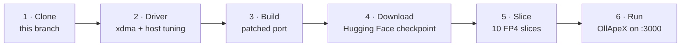
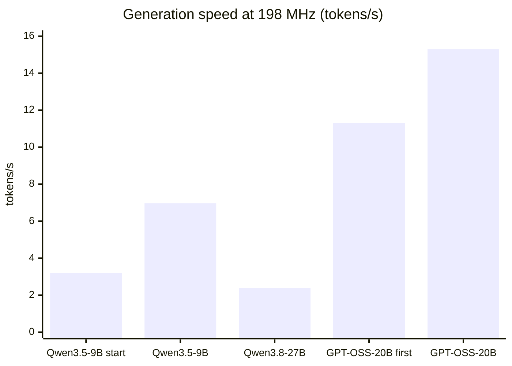
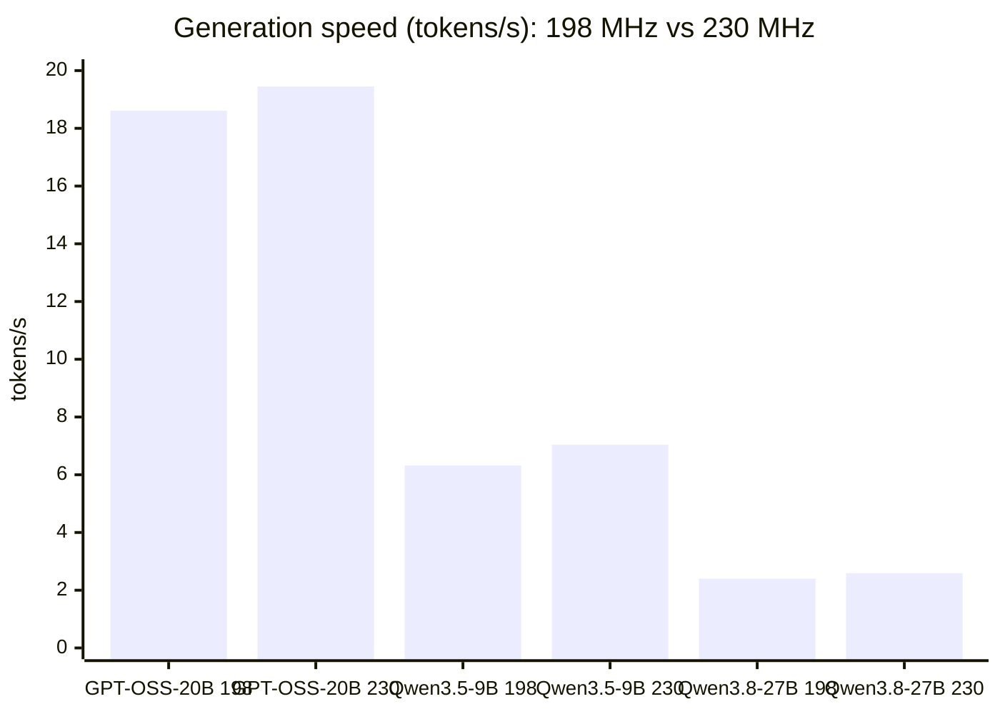
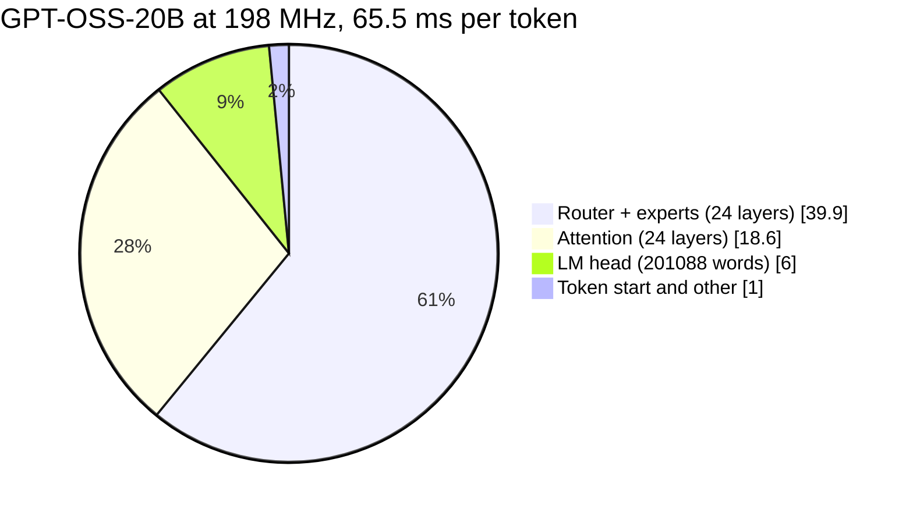
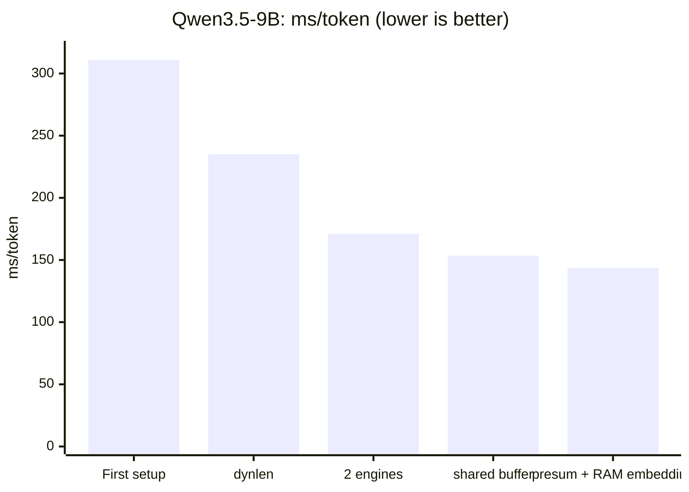
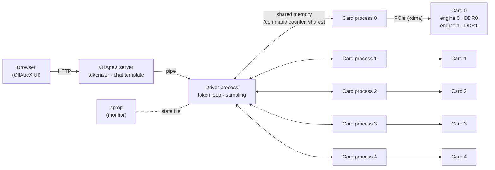
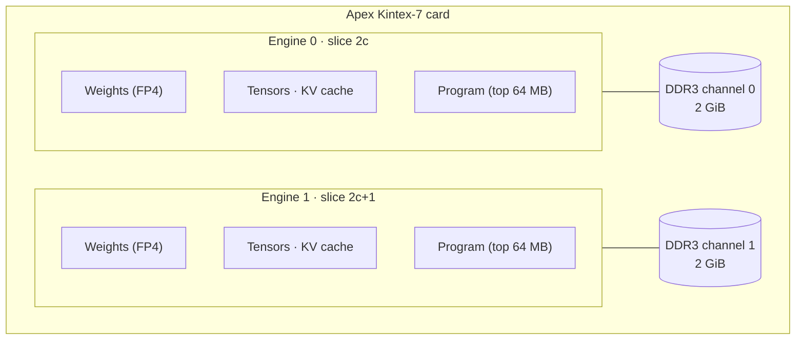
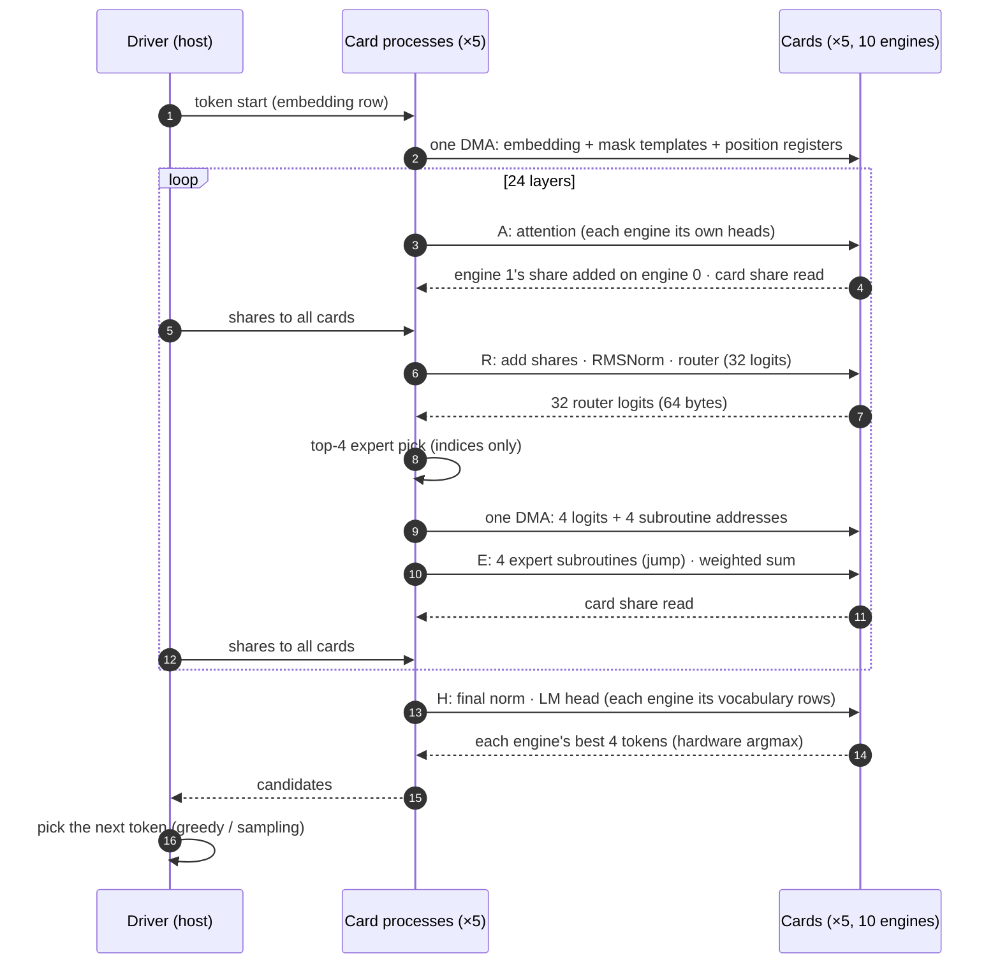
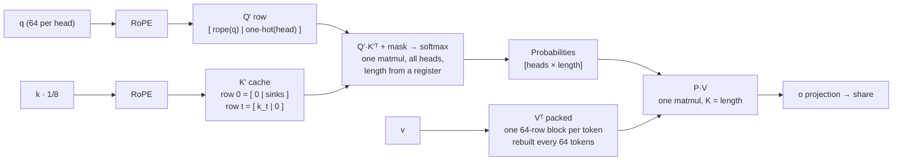

# Large language models on 5 Apex FPGA cards — overview and results

This work runs **GPT‑OSS‑20B, Gemma 4 26B‑A4B, Qwen3.5‑9B and Qwen3.8‑27B tensor-parallel on five Apex Kintex‑7 cards**, with a web chat interface (OllApeX).

**The host CPU and RAM are not used for inference.** Weights, the embedding table, the KV cache and every computation (attention, FFN, experts, norms, sums of the shards' results) live on the cards. The host only coordinates: tokenizer, commands, moving bytes between the cards (shares and the one embedding row a token needs, copied from the card that holds it), and choosing indices from values the cards computed (the top-k experts, the next token).

It is the vendor's [unified-engine](https://github.com/apex-compute/unified-engine) runtime (matching card firmware `c7de4c55`, 230 MHz) plus this project in [`models/apex-tp-llm/`](./). The vendor's original guide (XDMA driver, hardware tests, single-card models) is in [README.unified-engine.md](../../README.md).

| Model | Cards | Context | Generation | Prompt reading |
|---|---|---|---|---|
| **GPT‑OSS‑20B** (MoE, 21B / 3.6B active) | 5 cards × 2 engines | 8192 | **21.1 tokens/s** | 21.4 tokens/s |
| **Gemma 4 26B‑A4B** (MoE, 25B / 3.8B active) | 5 cards × 2 engines | 8192 | **17.1 tokens/s** | 17.3 tokens/s |
| **Qwen3.5‑9B** | 5 cards × 2 engines | 16384 | **7.35 tokens/s** | 7.4 tokens/s |
| **Qwen3.8‑27B** | 5 cards × 2 engines | 8192 | **2.76 tokens/s** | 2.8 tokens/s |

<sub>HP Z420 (Xeon E5‑2689, 32 GB), 5 × Apex Kintex‑7, firmware `c7de4c55` (230 MHz), 4‑bit FP4 weights, greedy decoding. The optimization history below was measured at 198 MHz; see [Firmware update](#firmware-update-198--230-mhz).</sub>

**Images:** Gemma 4's vision encoder runs on the cards too, tensor-parallel on 8 engines: 5.3 / 11.4 / 26.5 s for a 70 / 140 / 280-token image. The image enters the language model as one block with the model's exact attention rule ([docs/FINDINGS.md §9](docs/FINDINGS.md#9-gemma-4-images-the-encoder-and-the-image-block-on-the-cards)).

---

## Contents

1. [Quick start](#quick-start)
2. [Starting point](#starting-point)
3. [Results](#results)
4. [Architecture](#architecture)
5. [What was built](#what-was-built)
6. [Step-by-step setup](#step-by-step-setup)
7. [Usage](#usage)
8. [Repository layout](#repository-layout)
9. [Technical details](docs/TECHNICAL.md)

---

## Quick start



```bash
git clone -b 5-Apex-fpga https://github.com/dogankumova/unified-engine.git ~/unified-engine
cd ~/unified-engine/models/apex-tp-llm
export APEX_TP_WORK=~/apex_tp APEX_TP_CPUS=8,9,10,11,12,13

# (driver and host tuning: see "Step-by-step setup" below)
python port_build.py --name q35_9b --cfg9b silu kpad attn1 noeye heads shard recgrp tp abfuse vtshare membase cardsum dynlen ctx16k if4mix
python tools/download_models.py gpt-oss-20b
python extract_gptoss.py 10
python gptoss_tp.py --engines 2 --max-context 8192 --prompt "Write a short paragraph about bicycles."
```

The sliced weights are **not** in this repository (about 36 GB for the three models). The scripts above download the original checkpoints and produce them on your machine:

| Model | Download | Sliced result | Slicing time (this host) |
|---|---|---|---|
| GPT‑OSS‑20B | ~13 GB | ~12 GB | ~16 min (4 parallel copies + LM head) |
| Qwen3.5‑9B | ~19 GB | ~6.4 GB | ~6 min |
| Qwen3.8‑27B | ~52 GB | ~17 GB | ~22 min (4 parallel copies + LM head) |

The card programs are not stored either. They are compiled every time a model is loaded onto the cards; for GPT‑OSS this takes 15–35 s.

---

## Starting point

| | |
|---|---|
| **Host** | HP Z420 workstation, Intel Xeon E5‑2689 (8 cores / 16 threads), 32 GB RAM |
| **Cards** | 5 × Apex Kintex‑7: four in PCIe 2.0 x4 slots, one in a PCIe 2.0 x1 slot |
| **Per card** | 2 compute engines, 2 × 2 GiB DDR3 channels, firmware `a4fba9d9`, 198 MHz |
| **Software** | Fresh Ubuntu 24.04.5, kernel 7.0; no driver, no runtime, no Python environment |
| **Goal** | Run large models with all 5 cards working on the same token, as fast as possible |

The first working setup ran Qwen3.5‑9B on the 5 cards with one engine per card at **3.2 tokens/s** (context 4096).

| Card | PCI address | Link | Attached to |
|---|---|---|---|
| 0 | `03:00.0` | Gen2 x4 | CPU root port |
| 1 | `04:00.0` | Gen2 x4 | CPU root port |
| 2 | `05:00.0` | Gen2 x4 | x16 slot |
| 3 | `06:00.0` | Gen2 x4 | chipset |
| 4 | `07:00.0` | Gen2 x1 | chipset |

---

## Results

### Speed

Measured at 198 MHz (firmware `a4fba9d9`), at the end of the optimization work.



| Model | Weights on the cards | Context | Generation | ms/token | Prompt reading |
|---|---|---|---|---|---|
| GPT‑OSS‑20B, short reply | 11 GB | 8192 | **15.3 tokens/s** | 65.5 | 15.5 tokens/s (OllApeX: ~17) |
| GPT‑OSS‑20B, 900‑token reply | 11 GB | 8192 | 14.6 tokens/s | 68.4 | — |
| Qwen3.5‑9B | 4.5 GB | 16384 | 6.97 tokens/s | 143.6 | 6.9 tokens/s |
| Qwen3.8‑27B | 15 GB | 8192 | 2.39 tokens/s | 418 | 2.4 tokens/s |

- **GPT‑OSS‑20B:** the context size (2048 or 8192) does not change the speed. The cards only compute over the filled part of the context.
- **Qwen3.5‑9B at 16K context:** passes long-context retrieval tests. A fact placed at the start of a 1066-token and a 3021-token prompt is found.

### Firmware update: 198 → 230 MHz

The vendor's firmware `c7de4c55` runs the engines at 230 MHz instead of 198 MHz. Below, the same code, prompts and settings are run on both firmware versions, one after the other. The only software change is the firmware version check in `user_dma_core.py`.

**Generation speed**

| Model | 198 MHz (`a4fba9d9`) | 230 MHz (`c7de4c55`) | Gain |
|---|---|---|---|
| GPT‑OSS‑20B (MoE), 116-token reply | 53.7 ms/token · 18.61 tok/s | 51.4 ms/token · **19.45 tok/s** | **+4.5 %** |
| Qwen3.5‑9B, 16K context | 158.2 ms/token · 6.32 tok/s | 142.0 ms/token · **7.04 tok/s** | **+11.4 %** |
| Qwen3.8‑27B, 8K context | 416.6 ms/token · 2.40 tok/s | 385.5 ms/token · **2.59 tok/s** | **+8.1 %** |

**Prompt reading**

| Model | 198 MHz | 230 MHz | Gain |
|---|---|---|---|
| GPT‑OSS‑20B | 18.53 tok/s | 19.73 tok/s | +6.5 % |
| Qwen3.5‑9B | 6.37 tok/s | 7.08 tok/s | +11.1 % |
| Qwen3.8‑27B | 2.40 tok/s | 2.56 tok/s | +6.7 % |

**On-card compute per token (slowest engine)**

| Model | 198 MHz | 230 MHz | Change |
|---|---|---|---|
| Qwen3.5‑9B | 137.9 ms | 118.1 ms | −14.4 % |
| Qwen3.8‑27B | 377.4 ms | 323.6 ms | −14.3 % |



- The cards' compute scales with the clock: 198 / 230 = 0.86, and compute time per token dropped by 14 %.
- The gain per token is smaller than 14 % because part of every token is host-side synchronization over PCIe, and that part does not depend on the card clock. GPT‑OSS‑20B has 73 sync points per token, so it gains the least.
- Output is bit-identical on all three models: the same greedy text, and for Qwen the same token IDs. GPT‑OSS expert picks agree on every layer across all cards.
- The comparison runs use fixed short prompts. That is why GPT‑OSS‑20B at 198 MHz shows 53.7 ms/token here and 65.5 ms/token in the table above.
- The headline numbers at the top come from a later run of the same benchmark on a less busy host: GPT‑OSS‑20B 47.4 ms/token, Qwen3.5‑9B 136.0 ms/token, Qwen3.8‑27B 362.3 ms/token. On-card compute in that run was the same as in the comparison above (118.1 / 323.6 ms); only host-side time was lower.
- How to update the cards: step 3 of the [setup](#3-xdma-driver-and-host-tuning).

### Where one GPT‑OSS‑20B token goes

Measured at 198 MHz.



### GPT‑OSS‑20B: what each optimization brought

Each row was measured against the step before it, under the same conditions.

| Optimization | Gain (ms/token) |
|---|---|
| One DMA for token start and for the expert pick | −11.5 |
| Persistent DMA files, direct register access, no numpy on the hot host path | −10.9 |
| Expert pick done locally in each card process | −3.9 |
| GELU on 64×64 blocks (45 → 8.6 µs per expert) | −4.5 |
| P·V only over the filled context | −3.3 |
| QK + softmax and P·V of all heads in one matmul each | −3.1 |
| **Overall** | **11.3 → 15.3 tokens/s** |

### Qwen3.5‑9B: ms/token over the optimization steps



### Accuracy

- Card outputs were checked step by step against a PyTorch reference that uses the same quantized weights.
- GPT‑OSS expert layer relative error is 0.5–1.1 %, router logits 0.3–0.5 %. The picked top‑4 experts match the reference.
- The 5 cards' expert picks are identical in every layer; the runner checks this on every token.

| Format | SQNR (27B weights) | Top‑1 accuracy, 9B (code / plain text) |
|---|---|---|
| **FP4 (used)** | 19.45 dB | **60.46 % / 97.0 %** |
| INT4 | 18.90 dB | — |
| IF4mix | 19.95 dB | 60.16 % / 95.4 % |

---

## Architecture

### Overview



- **Tensor parallelism:** Every card holds a slice of every layer, and all cards work on the same token at the same time. Each card has two engines and each engine is one slice, so there are 10 slices.
- **Sync points:** A layer's output is the sum of all slices' shares. Each card returns its share (the sum of its two engines), and the host hands all shares to every card. The cards do the adding, so the residual stream stays on the cards.
- **No card-to-card link:** Every exchange goes over PCIe through host memory. Keeping the fixed cost per sync point low is the key to speed.

| CPU | Runs |
|---|---|
| 0–7 | xdma completion threads (poll mode, one per core) |
| 8 | OllApeX driver process (token loop) |
| 9–13 | 5 card processes, one per card, each driving both engines of its card |

### Inside a card



One engine reads weights at ~5.7 GB/s. Two engines on separate DDR channels reach ~11.4 GB/s together, so the second engine almost doubles the bandwidth.

### GPT‑OSS‑20B on the cards

| Slice | Card / engine | Query heads | Neurons of every expert | LM head rows |
|---|---|---|---|---|
| 0, 1 | 0 / 0, 0 / 1 | 4 each | 320 | 20160 |
| 2, 3 | 1 / 0, 1 / 1 | 4 each | 320 | 20096 |
| 4 | 2 / 0 | 8 | 320 | 20096 |
| 5–9 | 2/1 … 4/1 | 8 | 256 | 20096 |

All 32 experts are split over the 10 slices by neurons. Whichever 4 experts are picked, every engine does the same amount of work, and the whole model (~11 GB) stays resident on the cards.



### Attention: all heads in one matrix multiplication



---

## What was built

| Area | What | Result |
|---|---|---|
| **Host** | xdma driver for kernel 7.0, poll mode, `apex-tune` (performance governor, no deep C-states), CPU placement, systemd boot order | All 5 cards up at boot; ~10 µs per small DMA |
| **Qwen runtime** | Slicing every layer over 10 slices, sums on the cards, two engines on separate DDR channels, on-card pre-sum, dynamic attention length, 16K context, FP4 | 9B: 3.2 → 6.97 tokens/s; 27B: 2.39 tokens/s |
| **GPT‑OSS‑20B port** | New card program: MXFP4 → FP4, attention sinks, sliding window, YaRN, clamped SwiGLU, experts as precompiled subroutines picked through registers, card-local top‑4 pick, batched attention | 11.3 → 15.3 tokens/s |
| **Gemma 4 26B‑A4B port** | New card program: 128 experts with top‑8 plus a parallel dense FFN, sliding and global attention (K = V, partial RoPE by head-dim permutation), 1088-row KV ring for the sliding layers, router split over both engines, expert pick hidden behind the dense FFN | 15.7 → 17.1 tokens/s, context 8192 |
| **Gemma 4 images** | Vision encoder (27 layers, IF8) tensor-parallel on 8 engines, axial 2D RoPE by padding heads 72 → 128 with permuted dims, position / RoPE tables on the card, one program per detail level; exact image block in the language model (K / V of the whole image before its attention, per-token mask rows) | 70-token image in 5.3 s, 280 in 26.5 s; text speed unchanged |
| **Embedding on the cards** | Every model's table on the cards, one vocabulary block per shard (Qwen3.8‑27B as IF8, dequantized on the card); one row per token is copied from the card that holds it | Host RAM holds no model data; no measurable cost |
| **Firmware** | Vendor firmware `c7de4c55` (230 MHz) on all 5 cards, updated without a warm boot plus one power cycle; no code change | +4.5 % to +11.4 % tokens/s, identical output |
| **OllApeX** | Web chat UI, model and context choice, files, images (Qwen, Gemma 4), sampling, harmony format for GPT‑OSS (thinking / answer), math typesetting (KaTeX), live technical panel, systemd service | Use from any browser on port 3000 |
| **aptop** | Multi-card grid, live OllApeX state (model, phase, memory per card) | Monitor all cards in a terminal |
| **Tools** | Reference tests, step profilers, PCIe/DMA and memory benchmarks, quantization comparison | Every number in this README is reproducible |

The details of each item are in the [project README](README.md#what-was-built) and the [technical notes](docs/TECHNICAL.md).

---

## Step-by-step setup

### 1. Requirements

- Ubuntu 24.04, `build-essential`, kernel headers.
- Python 3.12 virtual environment: `pip install torch transformers safetensors huggingface_hub numpy==1.26.*` (CPU torch is enough).
- Cards on firmware `c7de4c55` (230 MHz). How to check and update them: step 3.

> All scripts call `torch.set_num_threads(1)`: on this Xeon, PyTorch's multi-threaded paths can use a CPU instruction the processor lacks.

### 2. Code

```bash
git clone -b 5-Apex-fpga https://github.com/dogankumova/unified-engine.git ~/unified-engine
```

### 3. xdma driver and host tuning

```bash
git clone https://github.com/Xilinx/dma_ip_drivers.git ~/dma_ip_drivers
cd ~/dma_ip_drivers/XDMA/linux-kernel/xdma
sed "s#/home/USER#$HOME#" ~/unified-engine/models/apex-tp-llm/system/xdma-makefile.patch | patch Makefile
make && sudo mkdir -p /lib/modules/$(uname -r)/xdma && sudo cp xdma.ko /lib/modules/$(uname -r)/xdma/

sudo cp ~/unified-engine/models/apex-tp-llm/system/{xdma,apex-tune}.service /etc/systemd/system/
sudo systemctl daemon-reload && sudo systemctl enable --now apex-tune xdma
ls /dev/xdma*_h2c_0          # one line per card
```

**Card firmware.** The runtime checks the firmware version of every card when it starts. Check the cards first:

```bash
cd ~/unified-engine
for d in /dev/xdma*_user; do python3 update_flash.py --dev $(basename $d _user) --is-current update_c7de4c55.bin; done
```

To update a card, write the flash without the warm boot, one card after the other. Then switch the machine off and on again:

```bash
cd ~/unified-engine
python3 -u update_flash.py update_c7de4c55.bin --dev xdma0 --no-boot     # repeat for xdma1 … xdma4
sudo poweroff                                                            # then power on again
```

- Each card takes about 1.5 minutes: erase, program (~32 s), and a byte-by-byte verify (~22 s).
- Stop OllApeX and every other program that uses the cards before you start.
- A power cycle is needed because the cards load their image from flash only at power-on. A software reboot is not enough.
- On the HP Z420, the vendor's one-step `update_fpga.sh` (warm boot plus a PCIe rescan of all cards) froze the host. `--no-boot` plus a power cycle avoids both steps.

### 4. Patched model port

```bash
cd ~/unified-engine/models/apex-tp-llm
export APEX_TP_WORK=~/apex_tp APEX_TP_CPUS=8,9,10,11,12,13
P="silu kpad attn1 noeye heads shard recgrp tp abfuse vtshare membase cardsum dynlen ctx16k if4mix"
python port_build.py --name q35_9b --cfg9b $P          # needed by every model, GPT-OSS included
```

### 5. Download and slice

```bash
# GPT-OSS-20B
python tools/download_models.py gpt-oss-20b
for r in 0:6 6:12 12:18 18:24; do GPTOSS_LAYERS=$r python extract_gptoss.py 10 & done; wait
GPTOSS_HEAD=1 GPTOSS_LAYERS=0:0 python extract_gptoss.py 10          # LM head, embedding, final norm

# Qwen3.5-9B
python tools/download_models.py qwen3.5-9b
APEX_Q4=fp4 Q_MODEL=q35_9b python extract_tp.py 10 fp4

# Qwen3.8-27B
python tools/download_models.py qwen3.8-27b
python port_build.py --name q38_27b --hfcfg $APEX_TP_WORK/models/q38_27b/qwen3.5_2b_bin/Qwen3.8-27B/config.json $P
for r in 0:16 16:32 32:48 48:64; do APEX_Q4=fp4 Q_MODEL=q38_27b TP_LAYERS=$r python extract_tp.py 10 fp4 & done; wait
APEX_Q4=fp4 Q_MODEL=q38_27b TP_HEAD=1 TP_LAYERS=0:0 python extract_tp.py 10 fp4
```

```bash
# Gemma 4 26B-A4B
python tools/download_models.py gemma-4-26b
for r in 0:8 8:16 16:23 23:30; do GEMMA4_LAYERS=$r python gemma4/extract_gemma4.py & done; wait
GEMMA4_HEAD=1 GEMMA4_LAYERS=0:0 python gemma4/extract_gemma4.py      # LM head, embedding, final norm
python gemma4/extract_gemma4_vision.py                               # image encoder (IF8) -> vision/vision.pt, ~1 min

# every model: its embedding table goes onto the cards (one vocabulary block per shard, never in host RAM)
EMB_WORK=$APEX_TP_WORK/models/gemma4_26b TPDIR=tp10    python tools/slice_embed.py
EMB_WORK=$APEX_TP_WORK/models/gptoss20b  TPDIR=tp10    python tools/slice_embed.py
EMB_WORK=$APEX_TP_WORK/models/q35_9b     TPDIR=tp10fp4 python tools/slice_embed.py
EMB_WORK=$APEX_TP_WORK/models/q38_27b    TPDIR=tp10fp4 python tools/slice_embed8.py   # IF8: bf16 does not fit next to the 27B weights
```

The slices land in `$APEX_TP_WORK/models/<model>/tp10…`. OllApeX lists a model as soon as its slices are there.

### 6. OllApeX service

```bash
sed "s/USER/$USER/g" system/ollapex.service | sudo tee /etc/systemd/system/ollapex.service
sudo systemctl daemon-reload && sudo systemctl enable --now ollapex
ollapex/ollapex.sh status
```

Open `http://<host>:3000`.

---

## Usage

### Web interface

Pick **gpt-oss:20b**, **gemma4:26b**, **qwen3.5:9b** or **qwen3.8:27b** from the model menu. The first time a model is chosen it is loaded onto the cards: ~40 s for GPT‑OSS, ~2.5 min for Gemma 4 with its image encoder, ~1.5–2 min for 27B. Attach an image and pick the **Image detail** to ask about it (Gemma 4: up to 70 / 140 / 280 tokens).

### API

```bash
curl -X POST localhost:3000/api/load -d '{"model": "gpt-oss:20b", "num_ctx": 8192}'
curl -N -X POST localhost:3000/api/chat -d '{
  "model": "gpt-oss:20b",
  "messages": [{"role": "user", "content": "What is the capital of France?"}],
  "options": {"temperature": 0.7, "top_k": 4, "num_predict": 1024}
}'
```

`/api/chat` streams newline-delimited JSON events: `status`, `thinking`, `content`, and `done` (with speed and timing statistics).

### Command line

```bash
python gptoss_tp.py --engines 2 --max-context 8192 --max-new-tokens 200 --prompt "..."
GPTOSS_PROF=1 python gptoss_tp.py ...                     # per-card, per-step time breakdown
Q_MODEL=q35_9b python run_tp.py --tp 10fp4 --engines 2 --max-context 16384 --prompt "..."
GEMMA4_VISION_SHARDS=8 GEMMA4_MAX_BLOCK=288 python gemma4/gemma4_tp.py --max-context 8192 \
    --image ../test_samples/people.jpg --soft 70 --prompt "Describe this image."   # Gemma 4 with an image
```

---

## Repository layout

```
unified-engine/  (branch 5-Apex-fpga)
├── README.md                  this file
├── README.unified-engine.md   the vendor's original guide
├── … vendor runtime (user_dma_core.py, quant_lib.py, models/qwen3.5_2b, …)
└── models/apex-tp-llm/
    ├── port_build.py · extract_tp.py · run_tp.py · vision_prep.py     Qwen tensor-parallel runtime
    ├── gptoss_card.py · gptoss_tp.py · extract_gptoss.py              GPT-OSS-20B runtime
    ├── gemma4/         Gemma 4 26B-A4B runtime (card program, runner, slicing, image encoder)
    ├── ollapex/        chat interface (server, engine, GPT-OSS and Gemma 4 backends, web page)
    ├── system/         systemd services, xdma Makefile patch
    ├── aptop/          aptop multi-card patch
    ├── tools/          download_models.py, tests, benchmarks, profilers
    ├── docs/TECHNICAL.md · docs/FINDINGS.md
    └── README.md       project README
```
