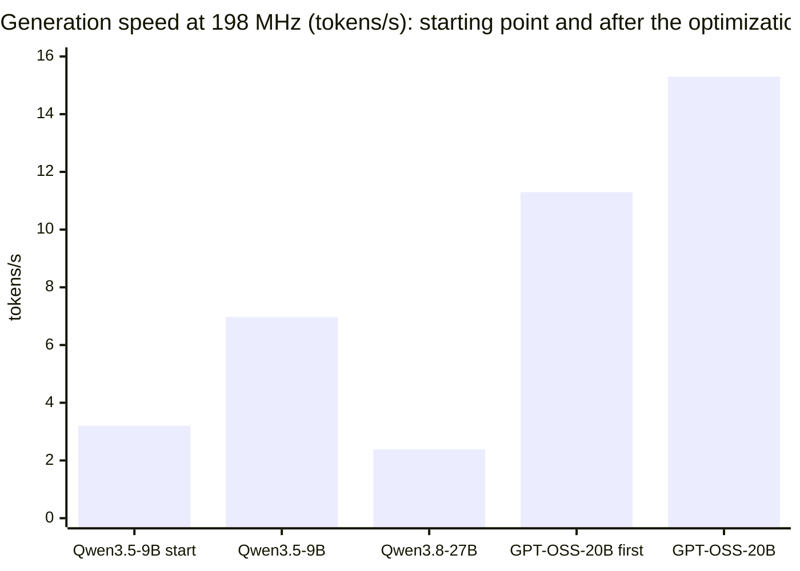
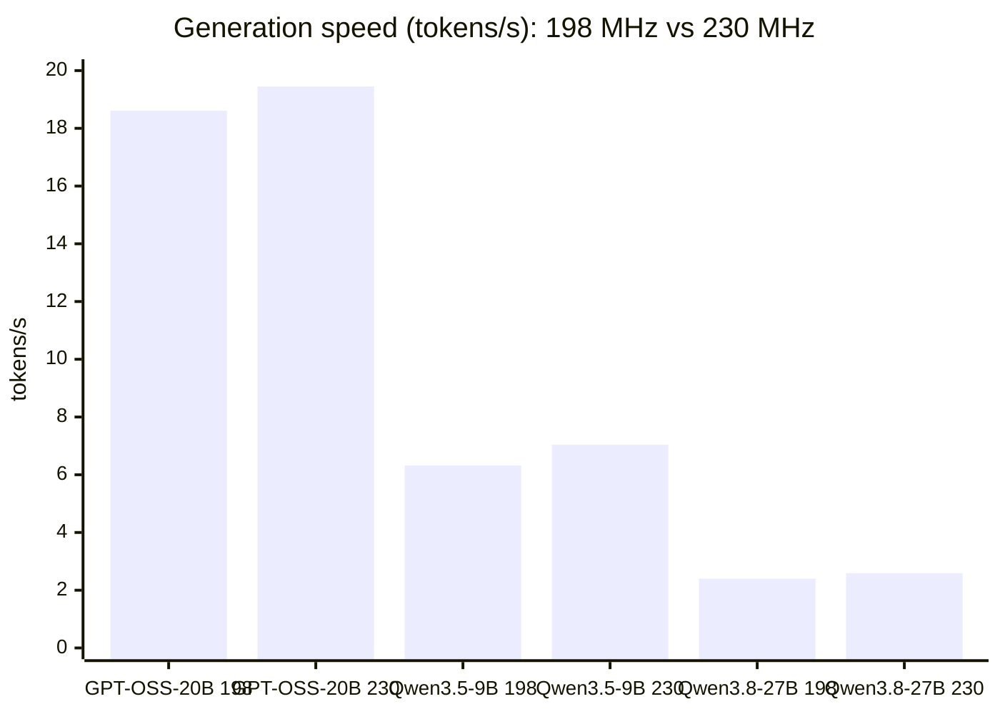
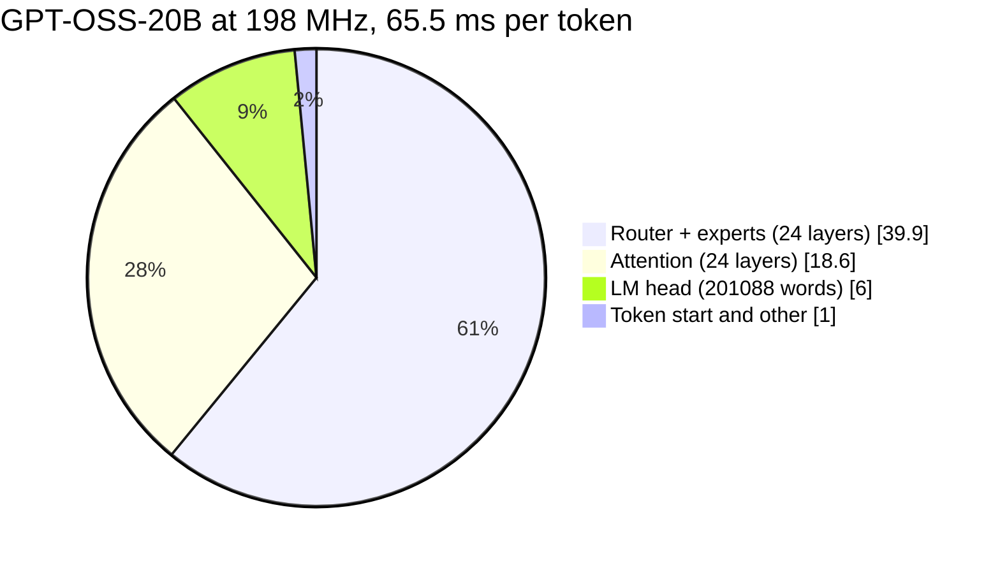
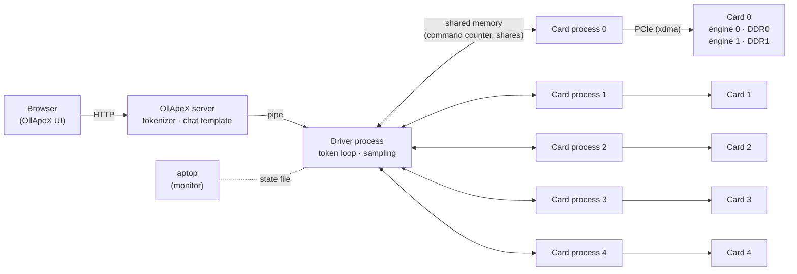
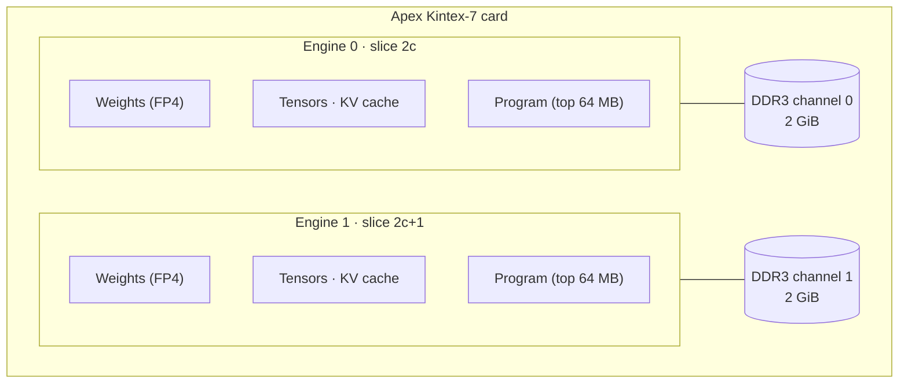
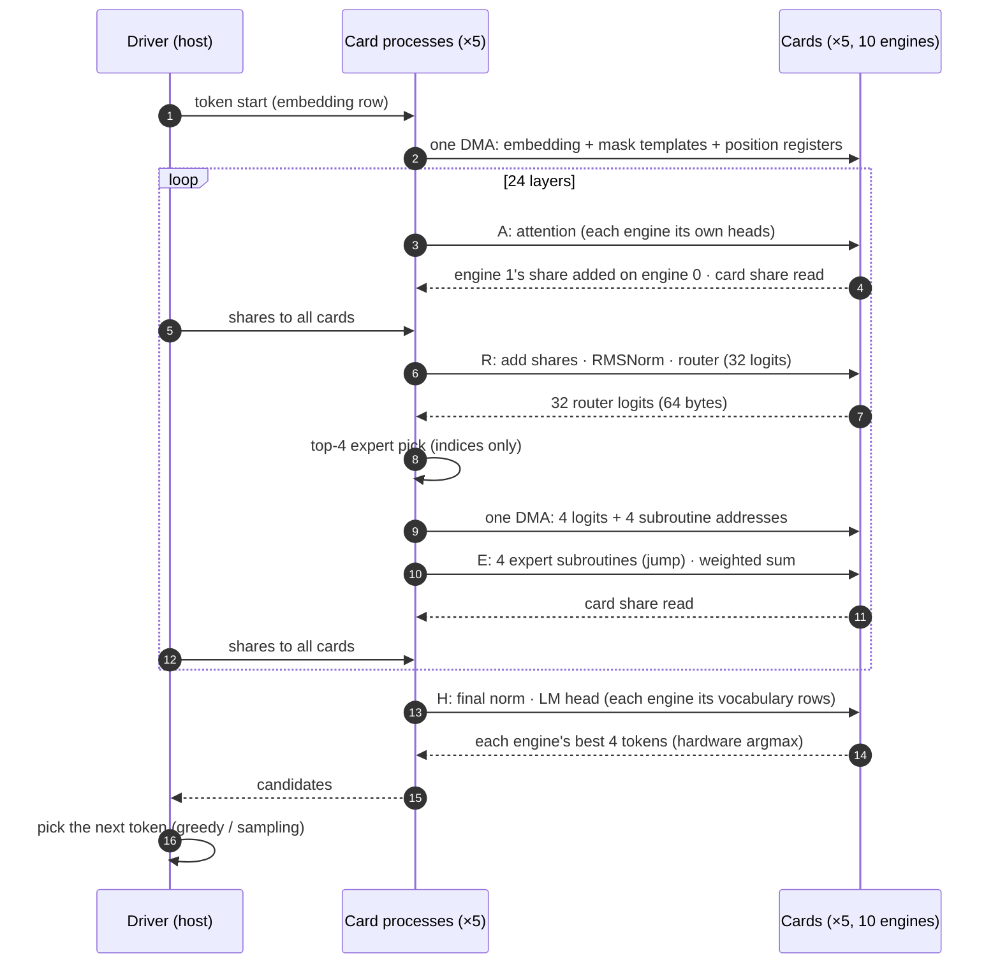
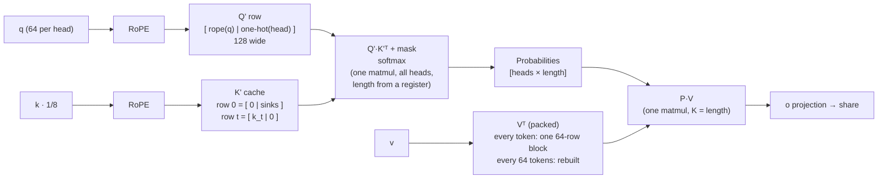
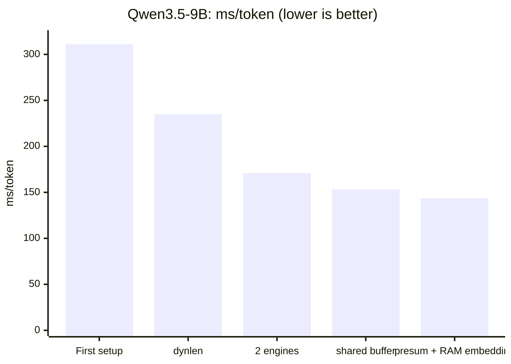

# apex-tp-llm

**Run large language models tensor-parallel across several Apex FPGA cards, with the OllApeX chat interface on top.**

**The host CPU and RAM are not used for inference.** Weights, the embedding table, the KV cache and every computation (attention, FFN, experts, norms, sums of the shards' results) live on the cards. The host only coordinates: tokenizer, commands, moving bytes between the cards (shares and the one embedding row a token needs, copied from the card that holds it), and choosing indices from values the cards computed (the top-k experts, the next token).

| Model | Cards | Context | Generation | Prompt reading |
|---|---|---|---|---|
| **GPT‑OSS‑20B** (MoE) | 5 cards × 2 engines | 8192 | **21.1 tokens/s** | 21.4 tokens/s |
| **Gemma 4 26B‑A4B** (MoE) | 5 cards × 2 engines | 8192 | **17.1 tokens/s** | 17.3 tokens/s |
| **Qwen3.5‑9B** | 5 cards × 2 engines | 16384 | **7.35 tokens/s** | 7.4 tokens/s |
| **Qwen3.8‑27B** | 5 cards × 2 engines | 8192 | **2.76 tokens/s** | 2.8 tokens/s |

<sub>HP Z420, 5 × Apex Kintex‑7, firmware `c7de4c55` (230 MHz), 4‑bit FP4 weights, greedy decoding. Details in [Results](#results) and [Firmware update: 198 → 230 MHz](#firmware-update-198--230-mhz).</sub>

**Gemma 4 also reads images on the cards:** its vision encoder runs tensor-parallel on 8 engines (5.3 s for a 70-token image, 11.4 s for 140, 26.5 s for 280), and the image enters the language model as one block with the model's exact attention rule. See [Gemma 4 images](#gemma-4-images).

---

> **Overview, optimization history and measurement charts:** [OVERVIEW.md](OVERVIEW.md).  
> **Card program internals:** [docs/TECHNICAL.md](docs/TECHNICAL.md).  
> **Findings, how Gemma 4 is sliced, compiled and pipelined, and how it reads images:** [docs/FINDINGS.md](docs/FINDINGS.md).

## Contents

1. [Starting point](#starting-point)
2. [Results](#results)
3. [Architecture](#architecture)
4. [What was built](#what-was-built)
5. [Installation](#installation)
6. [Usage](#usage)
7. [Repository layout](#repository-layout)
8. [Technical details](docs/TECHNICAL.md)
9. [Findings: what the measurements taught us](docs/FINDINGS.md) (incl. how Gemma 4 is sliced, compiled and pipelined, and object detection next to it)

---

## Starting point

| | |
|---|---|
| **Host** | HP Z420 workstation, Intel Xeon E5‑2689 (8 cores / 16 threads), 32 GB RAM |
| **Cards** | 5 × Apex Kintex‑7: four in PCIe 2.0 x4 slots, one in a PCIe 2.0 x1 slot |
| **Per card** | 2 compute engines, 2 × 2 GiB DDR3 channels, firmware `a4fba9d9`, 198 MHz |
| **Software** | Fresh Ubuntu 24.04.5, kernel 7.0; no driver, no runtime, no Python environment |
| **Goal** | Run large models with all 5 cards working on the same token, as fast as possible |

The first working setup ran Qwen3.5‑9B on the 5 cards with one engine per card at **3.2 tokens/s** (context 4096). The rest of this README describes how the system got from there to where it is now. All optimization work was done at 198 MHz. Afterwards the cards were updated to the vendor's firmware `c7de4c55` (230 MHz) with no code change ([Firmware update](#firmware-update-198--230-mhz)).

### PCIe layout of the cards

| Card | PCI address | Link | Attached to |
|---|---|---|---|
| 0 | `03:00.0` | Gen2 x4 | CPU root port |
| 1 | `04:00.0` | Gen2 x4 | CPU root port |
| 2 | `05:00.0` | Gen2 x4 | x16 slot |
| 3 | `06:00.0` | Gen2 x4 | chipset |
| 4 | `07:00.0` | Gen2 x1 | chipset |

---

## Results

### Speed

Measured at 198 MHz (firmware `a4fba9d9`), at the end of the optimization work. For the 230 MHz numbers see [Firmware update](#firmware-update-198--230-mhz).



| Model | Weights on the cards | Context | Generation | ms/token | Prompt reading |
|---|---|---|---|---|---|
| GPT‑OSS‑20B, short reply | 11 GB | 8192 | **15.3 tokens/s** | 65.5 | 15.5 tokens/s (OllApeX: ~17) |
| GPT‑OSS‑20B, 900‑token reply | 11 GB | 8192 | 14.6 tokens/s | 68.4 | — |
| Qwen3.5‑9B | 4.5 GB | 16384 | 6.97 tokens/s | 143.6 | 6.9 tokens/s |
| Qwen3.8‑27B | 15 GB | 8192 | 2.39 tokens/s | 418 | 2.4 tokens/s |

- For GPT‑OSS‑20B the context size (2048 or 8192) does not change the speed. The cards only compute over the part of the context that is filled.
- Qwen3.5‑9B at 16K context passes long-context retrieval tests: a fact placed at the start of a 1066-token and a 3021-token prompt is found.

### Firmware update: 198 → 230 MHz

The vendor's firmware `c7de4c55` runs the engines at 230 MHz instead of 198 MHz. Below, the same code, prompts and settings are run on both firmware versions, one after the other. The only software change is the firmware version check in `user_dma_core.py`.

**Generation speed**

| Model | 198 MHz (`a4fba9d9`) | 230 MHz (`c7de4c55`) | Gain |
|---|---|---|---|
| GPT‑OSS‑20B (MoE), 116-token reply | 53.7 ms/token · 18.61 tok/s | 51.4 ms/token · **19.45 tok/s** | **+4.5 %** |
| Qwen3.5‑9B, 16K context | 158.2 ms/token · 6.32 tok/s | 142.0 ms/token · **7.04 tok/s** | **+11.4 %** |
| Qwen3.8‑27B, 8K context | 416.6 ms/token · 2.40 tok/s | 385.5 ms/token · **2.59 tok/s** | **+8.1 %** |

**Prompt reading**

| Model | 198 MHz | 230 MHz | Gain |
|---|---|---|---|
| GPT‑OSS‑20B | 18.53 tok/s | 19.73 tok/s | +6.5 % |
| Qwen3.5‑9B | 6.37 tok/s | 7.08 tok/s | +11.1 % |
| Qwen3.8‑27B | 2.40 tok/s | 2.56 tok/s | +6.7 % |

**On-card compute per token (slowest engine)**

| Model | 198 MHz | 230 MHz | Change |
|---|---|---|---|
| Qwen3.5‑9B | 137.9 ms | 118.1 ms | −14.4 % |
| Qwen3.8‑27B | 377.4 ms | 323.6 ms | −14.3 % |



- The cards' compute scales with the clock: 198 / 230 = 0.86, and compute time per token dropped by 14 %.
- The gain per token is smaller than 14 % because part of every token is host-side synchronization over PCIe, and that part does not depend on the card clock. GPT‑OSS‑20B has 73 sync points per token, so it gains the least.
- Output is bit-identical on all three models: the same greedy text, and for Qwen the same token IDs. GPT‑OSS expert picks agree on every layer across all cards.
- The comparison runs use fixed short prompts. That is why GPT‑OSS‑20B at 198 MHz shows 53.7 ms/token here and 65.5 ms/token in the table above.
- The headline numbers at the top come from a later run of the same benchmark on a less busy host: GPT‑OSS‑20B 47.4 ms/token, Qwen3.5‑9B 136.0 ms/token, Qwen3.8‑27B 362.3 ms/token. On-card compute in that run was the same as in the comparison above (118.1 / 323.6 ms); only host-side time was lower.
- How to update the cards: [Card firmware](#card-firmware).

### GPT‑OSS‑20B: where the time of one token goes

Measured at 198 MHz.



### Accuracy

- Card outputs were checked step by step against a PyTorch reference that uses the same quantized weights.
- GPT‑OSS expert layer relative error: 0.5–1.1 %. Router logits: 0.3–0.5 %. The top‑4 experts the card picks match the reference.
- All 5 cards compute the router and each card picks its experts itself. The 5 picks are identical in every layer; the runner checks this on every token.

### Quantization: FP4

The cards use 4-bit **FP4 (E2M1)** with one bf16 scale per 64 values.

| Format | SQNR (27B weights) | Top‑1 accuracy, 9B (code / plain text) |
|---|---|---|
| **FP4** | 19.45 dB | **60.46 % / 97.0 %** |
| INT4 | 18.90 dB | — |
| IF4mix | 19.95 dB | 60.16 % / 95.4 % |

FP4 is the simplest format and gives the best prediction accuracy.

---

## Architecture

### Overview



- **Tensor parallelism:** Every card holds a slice of every layer, and all 5 cards work on the same token at the same time. Each card has two engines and each engine is one slice, so there are 10 slices.
- **Sync points:** A layer's output is the sum of all slices' shares. Each card returns its share (the sum of its two engines), and the host hands all shares to every card. The cards do the adding, so the residual stream stays on the cards.
- **There is no link between the cards.** Every exchange goes over PCIe through host memory. Keeping the fixed cost per sync point low is the key to speed.

### Processes and CPU placement

| CPU | Runs | Note |
|---|---|---|
| 0–7 | xdma completion threads | Driver in poll mode, each thread bound to one core |
| 8 | OllApeX driver process (token loop) | First entry of `APEX_TP_CPUS` |
| 9–13 | 5 card processes (one per card) | Each drives both engines of its card |

The card processes open their DMA channels once and do small transfers with direct `pwrite`/`pread` calls. One small transfer takes ~10 µs on an x4 card and ~13 µs on the x1 card.

### Inside a card: two engines, two memory channels



Each engine uses its own DDR channel. One engine reads weights at ~5.7 GB/s, and two engines on separate channels reach ~11.4 GB/s together, so the second engine almost doubles the bandwidth.

### How GPT‑OSS‑20B is split across the cards

GPT‑OSS‑20B has:
- 24 layers, hidden size 2880.
- 64 query heads and 8 KV heads.
- 32 experts, 4 active per token.
- Sliding-window (128) and full-attention layers, alternating.
- Attention sinks and YaRN RoPE.
- A vocabulary of 201088 tokens.

| Slice | Card / engine | Query heads | Expert neurons (for each of the 32 experts) | LM head rows |
|---|---|---|---|---|
| 0 | 0 / 0 | 4 | 320 | 20160 |
| 1 | 0 / 1 | 4 | 320 | 20160 |
| 2 | 1 / 0 | 4 | 320 | 20096 |
| 3 | 1 / 1 | 4 | 320 | 20096 |
| 4 | 2 / 0 | 8 | 320 | 20096 |
| 5–9 | 2/1 … 4/1 | 8 | 256 | 20096 |

The neurons of every expert are split over the 10 slices. Whichever 4 experts are picked, every engine does the same amount of work, and no expert ever has to be moved between cards. The whole model (~11 GB) stays resident in card memory.

### GPT‑OSS‑20B: one token



There are **49 sync points per token**: attention and router+experts for every layer, plus the LM head.

### Attention: all heads in one matrix multiplication



- **Sinks:** The second half of a Q' row is the head's one-hot vector, and row 0 of the K' cache holds the sink values of all heads. The sink column therefore gets each head's own value, and one mask row serves every head.
- **Scale:** The 1/√64 = 1/8 scale is folded into the K weights and bias. It is a power of two, so this is exact.
- **Length:** The card's length register (a multiple of 64) sets the column count of QK and the K dimension of P·V. Empty context is never computed.

---

## What was built

### 1. Host and driver setup

| Work | Result |
|---|---|
| Built the Xilinx xdma driver for kernel 7.0 ([patch](system/xdma-makefile.patch)) | All 5 cards visible; the driver loads at boot |
| Put xdma in **poll mode** (`poll_mode=1`) | Polling instead of interrupts: lower latency for small transfers |
| Added the `apex-tune` service: performance governor, deep C-states (C3+) off | No CPU wake-up latency |
| CPU placement: card processes on 9–13, xdma threads on 0–7 | The processes do not get in each other's way |
| Persistent DMA files + direct `pwrite`/`pread` | ~10 µs per small transfer |
| Embedding table kept in RAM | No disk access per token |
| systemd services `xdma` → `apex-tune` → `ollapex` | Everything starts by itself at boot, in order |

### 2. Tensor-parallel runtime (Qwen3.5 family)

The vendor's Qwen3.5 port is left unchanged. `port_build.py` writes a patched copy of it into a work directory.

| Technique | Effect |
|---|---|
| **Slicing** (`extract_tp.py`): every card gets a slice of the heads and neurons of every layer | Models larger than one card's memory run |
| **Summing on the cards** (`cardsum`): the cards add the shares; the residual stays on the card | The host only moves bytes |
| **Two engines, two DDR channels**: one slice per engine, each in its own memory channel | 9B: 235 → 171 ms/token |
| **Shared parts buffer + on-card pre-sum** (`presum`): engine 1's share is added on engine 0 | One read per card: 171 → 143.6 ms/token |
| **Dynamic length** (`dynlen`): attention length comes from a card register | Empty context is not computed: 311 → 235 ms/token |
| **16K context** (`ctx16k`): one copy per KV head, persistent chunked Vᵀ | 9B runs with 16384 context |
| **Memory layout** (`membase`): separate parameter / tensor / program regions | The 27B weights and a long context fit together |
| **FP4 quantization** | Best prediction accuracy, simplest format |



### 3. GPT‑OSS‑20B (MoE) port

The card program for the GPT‑OSS architecture was written from scratch (`gptoss_card.py`, `gptoss_tp.py`, `extract_gptoss.py`).

| Component | Solution |
|---|---|
| MXFP4 expert weights | Unpacked with transformers' own converter, requantized to the card's FP4 |
| Attention sinks | Row 0 of the K' cache + the one-hot half of Q' |
| Sliding window (128) | The card updates the mask row on every token from two template copies |
| YaRN RoPE | transformers' own YaRN tables, with the same scaling |
| Clamped SwiGLU (GELU‑sigmoid, clamp 7) | The clamp runs inside the GEMV; GELU is an identity matmul on 64×64 blocks |
| Expert selection | The router runs on the card; each card process picks the top‑4 **indices** from its own card's 32 logits |
| Expert call | Every (layer, expert) is a precompiled subroutine; the card **jumps through a register** to the 4 picked ones (`jump_reg_abs`) |
| Expert weights | The softmax over the 4 logits runs on the card |
| Token start | Embedding, mask templates and 9 position registers are written with **one DMA** |

**Speed gains** (each row measured against the step before it, under the same conditions):

| Optimization | Gain (ms/token) |
|---|---|
| One DMA for token start and for the expert pick (instead of separate small programs) | −11.5 |
| Persistent DMA files, direct register access, no numpy on the hot host path | −10.9 |
| Expert pick done locally in each card process, `struct`‑based | −3.9 |
| GELU on 64×64 blocks (45 → 8.6 µs per expert) | −4.5 |
| P·V only over the filled context | −3.3 |
| QK + softmax and P·V of all heads in one matmul each | −3.1 |
| **Overall** | **11.3 → 15.3 tokens/s** |

On an 8-head slice the card time of attention went from 691 µs to 435 µs per layer, and the expert segment from 1237 µs to 1083 µs.

### 4. OllApeX chat interface

- **Web UI (port 3000):**
  - Model and context choice (256 – 16384).
  - File attachments.
  - Image input for the Qwen models (the vision encoder runs on a card) and Gemma 4 (the encoder runs on 8 engines; detail low / medium / high = up to 70 / 140 / 280 tokens).
  - Live technical panel: cards, links, speed, power estimate.
- **gpt-oss:20b:** harmony chat template. The model's analysis is shown as "thinking" and its answer as normal text. The "think" switch sets the reasoning effort (low / medium).
- **Math:** formulas in replies (`\[ … \]`, `$$ … $$`, `\( … \)`, `$ … $`) are typeset with [KaTeX](https://katex.org) 0.16.11, served from `ollapex/static/katex` (MIT license), so no internet access is needed. Markdown tables and horizontal rules are rendered too.
- **Sampling:** greedy or temperature / top‑k / top‑p. Every engine reports its best 4 tokens through the hardware argmax, and the host picks among the overall best candidates.
- Replies are limited to 1024 tokens by default.
- For the Qwen models and Gemma 4, the part of the previous conversation already held on the cards is reused; only the new message is read. A follow-up is built as the exact continuation of what the cards hold, because the chat templates render past turns differently (Gemma drops the empty thinking block it opened the turn with).
- **gemma4:26b:** Gemma 4 chat template; with "think" on, its thinking channel is shown as "thinking".
- The LM head is skipped while the prompt is read, so GPT‑OSS reads prompts at ~17 tokens/s.
- Between requests the card processes park and use no CPU.
- Runs as a systemd service: `ollapex.sh start | stop | restart | status | log`.

### 5. Gemma 4 26B‑A4B (MoE) port

New card program (`gemma4/`): 30 layers, 128 experts with top‑8 plus a parallel dense FFN, sliding (1024) and global attention (K = V, partial RoPE). How it is sliced, compiled and pipelined: [docs/FINDINGS.md §8](docs/FINDINGS.md).

| Step | Effect |
|---|---|
| First version (card-local top‑8 pick) | 63.7 ms/token, 15.7 tokens/s |
| Router split over the card's two engines | 61.7 ms/token (−2.0) |
| Dense FFN started before the expert pick; the pick runs while it computes | 58.8 ms/token (−2.9) |
| Sliding layers in a 1088-row KV ring | context 4096 → **8192** fits; sliding-attention time stays flat |
| Fused expert accumulation | 58.5 ms/token (−0.6) |

The output is bit-identical across all these steps.

#### Gemma 4 images

Both parts run on the cards. Details and measurements: [docs/FINDINGS.md §9](docs/FINDINGS.md#9-gemma-4-images-the-encoder-and-the-image-block-on-the-cards).

- **Vision encoder** (`gemma4/gemma4_vision_tp.py`): 27 layers, IF8 weights. FP4 gave 27 % token error against 2.1 % for IF8.
  - Tensor-parallel over the 8 engines of the x4 cards: heads and MLP blocks are split, with 2 synchronized segments per layer.
  - The 72-wide heads are padded to 128 with permuted dimensions, so the card's RoPE equals the model's axial 2D RoPE.
  - Position and RoPE tables are on the card; the host only writes one-hot selectors from the patch coordinates.
  - One precompiled program per detail level (70 / 140 / 280 soft tokens).
- **Image block in the language model** (`gemma4_card.compile_block`): inside an image every token sees the whole image (in the sliding layers), so the block is read layer by layer.
  - All image tokens' K / V of a layer are written before any of them attends, each token with its own mask row.
  - The sliding ring grows to 1376 rows (window + 64 + 288).

| Detail (soft tokens) | Encoder, 8 engines | 10 engines | Reading the block |
|---|---|---|---|
| 70 | **5.3 s** | 6.0 s | ~3.7 s for 60 tokens |
| 140 | **11.4 s** | 12.9 s | ~60 ms per token |
| 280 | **26.5 s** | 29.3 s | ~60 ms per token |

- **Accuracy:** soft tokens 6.0 % from a torch emulation of the same weights. The model's own bf16 path is 3.1 % from fp32.
- **Speed:** the 8 x4 engines are faster than all 10, because the encoder is compute-bound and the x1 link drops out of every sync. Generation after an image is unchanged (16.6–17.1 tokens/s).
- **Load time:** with image support Gemma 4 loads in ~160 s instead of ~47 s.
- **Settings:** `GEMMA4_VISION_SHARDS` (OllApeX default 8) and `GEMMA4_MAX_BLOCK` (default 288) turn it on; without them the runtime is the text-only one.

### 6. Embedding tables on the cards

Every model keeps its embedding table on the cards, one vocabulary block per shard (`tools/slice_embed.py`). For each token the driver copies the one row it needs from the card that holds it; the table is never in host RAM.

- Qwen3.8‑27B: the bf16 table (254 MB per engine) does not fit next to its weights, so it is stored as IF8 (`tools/slice_embed8.py`, 131 MB per engine) and the card dequantizes the row. Row error is 0.65–1.05 %, and the first ~30 generated tokens are identical to the bf16 version.
- Cost: none measurable (GPT‑OSS 47.4 → 47.3 ms/token).
- 27B needs a tighter weight-region margin: `OLLAPEX_PARAM_FACTOR=1.0 OLLAPEX_PARAM_SLACK_MB=64`, already in `system/ollapex.service`. The measured need is the on-disk size + ~31 MB.

### 7. aptop: multi-card monitoring

Patch for [aptop](https://github.com/celikomer/aptop), an nvtop-like monitor for Apex cards ([aptop/aptop-multicard.patch](aptop/aptop-multicard.patch)):

- Detects how many cards are installed and lays them out in a grid of up to 6 columns.
- OllApeX writes the state file aptop reads (`aptop-workload/v1`): the loaded model, the phase (loading / idle / prompt reading / generating), and per-card memory use (weights, KV, program).

### 8. Measurement and test tools

| Tool | What it measures |
|---|---|
| `tools/test_gptoss.py` | GPT‑OSS layer segments against a PyTorch reference (A / R / E error, top‑4 match) |
| `tools/prof_gptoss.py` | Times every card step of one layer separately |
| `tools/test_ctx16k.py`, `tools/test_dynlen.py`, `tools/needle.sh` | Qwen long-context correctness and retrieval test |
| `tools/bench_pcie.py`, `tools/bench_dmalat.py`, `tools/bench_dmaconc.py` | PCIe/DMA latency, one card and all 5 at once |
| `tools/bench_2eng.py` | Memory bandwidth of the two engines |
| `tools/quant_compare.py` | SQNR of the quantization formats |
| `tools/test_gemma4_vision.py` | Gemma 4 image encoder on one engine against a torch emulation of the same IF8 weights |
| `tools/test_gemma4_block.py` | Gemma 4 image block: every segment against a reference with the model's masks (sliding: window + whole image) |
| `tools/vision_tp_check.py` | Tensor-parallel encoder output (saved by `gemma4_tp.py --image`) against the emulation |
| `yolo26/test_yolo26.py` | YOLO26s-OBB on one engine, standalone: boxes on an image and the card time |
| `yolo26/debug_yolo26.py` | YOLO26s-OBB operation by operation against the float graph (chain and local SNR) |
| `tools/test_yolo26_load.py`, `tools/test_yolo26_chat.py` | Detection frames through the OllApeX API while Gemma generates; the chat about a detection result |
| `tools/download_models.py` | Downloads the Hugging Face checkpoints into the places the slicing scripts read |
| `run_tp.py --eval-file` | Teacher-forced top‑1 accuracy on the cards |

### 9. Object detection: YOLO26s-OBB next to Gemma 4

YOLO26s-OBB (oriented boxes, the 15 DOTA classes: plane, ship, storage tank, harbor, bridge, large / small vehicle, helicopter, …) runs on all 10 engines while Gemma 4 26B-A4B is loaded, each engine with its own copy in the memory the language model leaves free. Method and measurements: [docs/FINDINGS.md §10](docs/FINDINGS.md#10-object-detection-next-to-gemma-4-yolo26s-obb-on-the-same-cards).

- **Compiler** (`yolo26/yolo26_card.py`): lowers the pretrained network onto the vendor's CONV2D / MAXPOOL opcodes and YOLOv5 emitters (`models/yolov5s`), with the attention block as matmuls and a fused softmax, a 2 × 2 space-to-depth input, IF8 weights, and relocatable addresses. The program is cut into ~4 ms halt-terminated units.
- **Build per engine** (`yolo26/yolo26_build.py`): at Gemma 4 load, for the free weight and tensor ranges of each engine; cached in `yolo26/cache/`, so only the first load compiles.
- **Frame bus** (`yolo26/yolo26_bus.py`): 16 shared-memory frame slots between the web server, the driver and the card processes, plus the host's letterbox, packing, box decoding and a video tracker.
- **Runtime:** `gemma4/gemma4_tp.py` command `SEG_YOLO` runs units on both engines of a card. `ollapex/ollapex_gemma4.py` gives camera frames 20 ms after every Gemma token; uploaded images and videos run before the next chat command.
- **Detection page** (`ollapex/ollapex_yolo.py`, `ollapex/static/yolo.html`, at `/yolo`): image, video and webcam, with a chat that asks Gemma 4 about the result.

| | Result |
|---|---|
| One 640-px frame, one engine | 3.15 s |
| 10 engines, Gemma idle | 2.56 frames/s |
| While Gemma generates | 2.19 frames/s, Gemma 12.1 tok/s, identical greedy answer |
| Memory per engine | 52.2 MB weights + program, 35.5 MB tensors |

---

## Installation

### Requirements

- Ubuntu 24.04, `build-essential`, kernel headers.
- A Python 3.12 virtual environment with `torch` (CPU), `transformers` ≥ 5.20, `numpy` 1.26, `safetensors`.
- The vendor runtime [apex-compute/unified-engine](https://github.com/apex-compute/unified-engine), at a version that matches the card firmware (`c7de4c55`, 230 MHz).

> On this Xeon, PyTorch's multi-threaded paths can use a CPU instruction the processor lacks. All scripts run with `torch.set_num_threads(1)`.

### 1. Get the code

The branch `5-Apex-fpga` is the vendor runtime (matching firmware `c7de4c55`) with this project in `models/apex-tp-llm/`:

```bash
git clone -b 5-Apex-fpga https://github.com/dogankumova/unified-engine.git ~/unified-engine
```

### 2. xdma driver and host tuning

```bash
git clone https://github.com/Xilinx/dma_ip_drivers.git ~/dma_ip_drivers
cd ~/dma_ip_drivers/XDMA/linux-kernel/xdma
sed "s#/home/USER#$HOME#" ~/unified-engine/models/apex-tp-llm/system/xdma-makefile.patch | patch Makefile
make && sudo mkdir -p /lib/modules/$(uname -r)/xdma && sudo cp xdma.ko /lib/modules/$(uname -r)/xdma/

sudo cp ~/unified-engine/models/apex-tp-llm/system/{xdma,apex-tune}.service /etc/systemd/system/
sudo systemctl daemon-reload && sudo systemctl enable --now apex-tune xdma
ls /dev/xdma*_h2c_0          # one line per card
```

#### Card firmware

The runtime checks the firmware version of every card when it starts. Check the cards first:

```bash
cd ~/unified-engine
for d in /dev/xdma*_user; do python3 update_flash.py --dev $(basename $d _user) --is-current update_c7de4c55.bin; done
```

To update a card, write the flash without the warm boot, one card after the other. Then switch the machine off and on again:

```bash
cd ~/unified-engine
python3 -u update_flash.py update_c7de4c55.bin --dev xdma0 --no-boot     # repeat for xdma1 … xdma4
sudo poweroff                                                            # then power on again
```

- Each card takes about 1.5 minutes: erase, program (~32 s), and a byte-by-byte verify (~22 s).
- Stop OllApeX and every other program that uses the cards before you start.
- A power cycle is needed because the cards load their image from flash only at power-on. A software reboot is not enough.
- On the HP Z420, the vendor's one-step `update_fpga.sh` (warm boot plus a PCIe rescan of all cards) froze the host. `--no-boot` plus a power cycle avoids both steps.

### 3. Patched model port

```bash
cd ~/unified-engine/models/apex-tp-llm
export APEX_TP_WORK=~/apex_tp APEX_TP_CPUS=8,9,10,11,12,13

# patched Qwen port (GPT-OSS also builds on this port's engine class)
python port_build.py --name q35_9b --cfg9b silu kpad attn1 noeye heads shard recgrp tp abfuse vtshare membase cardsum dynlen ctx16k if4mix
python port_build.py --name q38_27b --hfcfg <Qwen3.8-27B dir>/config.json silu kpad attn1 noeye heads shard recgrp tp abfuse vtshare membase cardsum dynlen ctx16k if4mix
```

### 4. Models and slicing

Place the Hugging Face model directories under `$APEX_TP_WORK/models/<name>/qwen3.5_2b_bin/<Model>/` (a symlink is enough). For GPT‑OSS, point `GPTOSS_MODEL` at the model directory.

```bash
python tools/download_models.py all            # the Hugging Face checkpoints, into the places below

# Qwen: 10 slices (5 cards x 2 engines), FP4
APEX_Q4=fp4 Q_MODEL=q35_9b  python extract_tp.py 10 fp4      # -> $APEX_TP_WORK/models/q35_9b/tp10fp4
APEX_Q4=fp4 Q_MODEL=q38_27b python extract_tp.py 10 fp4      # -> $APEX_TP_WORK/models/q38_27b/tp10fp4

# GPT-OSS-20B: 10 slices; can run as parallel copies over layer ranges (GPTOSS_LAYERS=0:6 ...)
GPTOSS_MODEL=<gpt-oss-20b dir> python extract_gptoss.py 10   # -> $APEX_TP_WORK/models/gptoss20b/tp10

# Gemma 4 26B-A4B
python tools/download_models.py gemma-4-26b
for r in 0:8 8:16 16:23 23:30; do GEMMA4_LAYERS=$r python gemma4/extract_gemma4.py & done; wait
GEMMA4_HEAD=1 GEMMA4_LAYERS=0:0 python gemma4/extract_gemma4.py      # LM head, embedding, final norm
python gemma4/extract_gemma4_vision.py                               # image encoder (IF8) -> vision/vision.pt, ~1 min

# every model: its embedding table goes onto the cards (one vocabulary block per shard, never in host RAM)
EMB_WORK=$APEX_TP_WORK/models/gemma4_26b TPDIR=tp10    python tools/slice_embed.py
EMB_WORK=$APEX_TP_WORK/models/gptoss20b  TPDIR=tp10    python tools/slice_embed.py
EMB_WORK=$APEX_TP_WORK/models/q35_9b     TPDIR=tp10fp4 python tools/slice_embed.py
EMB_WORK=$APEX_TP_WORK/models/q38_27b    TPDIR=tp10fp4 python tools/slice_embed8.py   # IF8: bf16 does not fit next to the 27B weights
```

Object detection next to Gemma 4 (optional): a separate environment for the build step (torch and ultralytics are used at load time to read the checkpoint and compile it, never to run it), and the pretrained weights.

```bash
python3 -m venv yolo26/env
yolo26/env/bin/python -m pip install --index-url https://download.pytorch.org/whl/cpu torch
yolo26/env/bin/python -m pip install ultralytics imageio-ffmpeg
wget -P yolo26 https://github.com/ultralytics/assets/releases/download/v8.4.0/yolo26s-obb.pt
```

OllApeX turns it on by itself when `yolo26/env` and the weights exist: loading Gemma 4 then builds one detector per engine (~240 s the first time, ~168 s after that). Without them Gemma 4 loads as before, without the detector.

### 5. OllApeX service

```bash
sed "s/USER/$USER/g" system/ollapex.service | sudo tee /etc/systemd/system/ollapex.service
sudo systemctl daemon-reload && sudo systemctl enable --now ollapex
ollapex/ollapex.sh status
```

The interface is at `http://<host>:3000`.

---

## Usage

### Web interface

Pick **gpt-oss:20b**, **gemma4:26b**, **qwen3.5:9b** or **qwen3.8:27b** from the model menu. A model is loaded onto the cards the first time it is chosen: about 40 s for GPT‑OSS, about 2.5 minutes for Gemma 4 with its image encoder, about 1.5–2 minutes for the 27B model.

To ask about an image, attach it with **Attach file** and pick the **Image detail** (Gemma 4: low / medium / high = up to 70 / 140 / 280 tokens). The image is encoded once per detail level; follow-up questions reuse it.

### Object detection

With Gemma 4 loaded, open `http://<host>:3000/yolo` (or **YOLO** in the chat page header):
- **Image:** upload an image; oriented boxes, counts per class and a region grid.
- **Video:** upload a video and pick the sample rate; frames are tracked, with unique and peak counts per class.
- **Camera:** the browser's webcam; frames run on the cards while Gemma generates (the browser needs HTTPS or localhost for the camera).
- **Ask Gemma about these results:** the first question sends a compact summary of the detections, and optionally the picture; follow-ups reuse what the cards already read.

API: `POST /api/yolo/detect` (raw image body), `POST /api/yolo/video` (raw video body, `X-Fps`), `GET /api/yolo/job?id=`, `GET /api/yolo/status`.

### API

```bash
curl -X POST localhost:3000/api/load -d '{"model": "gpt-oss:20b", "num_ctx": 8192}'
curl localhost:3000/api/status
curl -N -X POST localhost:3000/api/chat -d '{
  "model": "gpt-oss:20b",
  "messages": [{"role": "user", "content": "What is the capital of France?"}],
  "think": false,
  "options": {"temperature": 0.7, "top_k": 4, "num_predict": 1024}
}'
```

`/api/chat` streams newline-delimited JSON events: `status`, `thinking`, `content`, and `done` (with speed and timing statistics).

An image: upload it, then refer to its id in a message.

```bash
curl -X POST localhost:3000/api/file -H "X-Filename: people.jpg" --data-binary @people.jpg   # -> {"image_id": ..., "plans": ...}
curl -N -X POST localhost:3000/api/chat -d '{
  "model": "gemma4:26b",
  "messages": [{"role": "user", "content": "Describe this image.", "images": ["<image_id>"]}],
  "options": {"image_detail": "low"}
}'
```

### Command line

```bash
# GPT-OSS-20B
python gptoss_tp.py --engines 2 --max-context 8192 --max-new-tokens 200 --prompt "..."
GPTOSS_PROF=1 python gptoss_tp.py ...        # step-by-step time breakdown per card

# Gemma 4 26B-A4B
python gemma4/gemma4_tp.py --max-context 8192 --max-new-tokens 200 --prompt "..."
GEMMA4_PROF=1 python gemma4/gemma4_tp.py ...    # step-by-step time breakdown per card
GEMMA4_VISION_SHARDS=8 GEMMA4_MAX_BLOCK=288 python gemma4/gemma4_tp.py --max-context 8192 \
    --image ../test_samples/people.jpg --soft 70 --prompt "Describe this image."   # image encoded on the cards

# Qwen (27B: export OLLAPEX_PARAM_FACTOR=1.0 OLLAPEX_PARAM_SLACK_MB=64 first)
Q_MODEL=q35_9b python run_tp.py --tp 10fp4 --engines 2 --max-context 16384 --prompt "..."
Q_MODEL=q35_9b python run_tp.py --tp 10fp4 --engines 2 --eval-file text.txt --eval-tokens 1000
```

---

## Repository layout

```
models/apex-tp-llm/           (in unified-engine, branch 5-Apex-fpga)
├── port_build.py             builds the patched copy of the Qwen3.5 port
├── extract_tp.py             Qwen slicing
├── run_tp.py                 Qwen tensor-parallel runner
├── vision_prep.py            Qwen vision encoder weights
├── gptoss_card.py            GPT-OSS card program (one engine = one slice)
├── gptoss_tp.py              GPT-OSS runner and card processes
├── extract_gptoss.py         GPT-OSS slicing (MXFP4 → FP4)
├── gemma4/                   Gemma 4 26B-A4B: card program, runner, slicing (gemma4_card / gemma4_tp / extract_gemma4),
│                             image encoder (gemma4_vision / gemma4_vision_tp / extract_gemma4_vision)
├── ollapex/                  chat interface: server, engine, GPT-OSS and Gemma 4 backends, web page, detection page
├── yolo26/                   YOLO26s-OBB next to Gemma 4: card compiler, per-engine build, frame bus, tests
├── system/                   systemd services and the xdma Makefile patch
├── aptop/                    aptop multi-card patch
├── tools/                    tests, benchmarks, profilers, slice_embed.py / slice_embed8.py
├── docs/TECHNICAL.md         card program, register map, measurements
└── docs/FINDINGS.md          what the measurements taught us; Gemma 4 slicing, compile, pipeline, images, object detection
```
