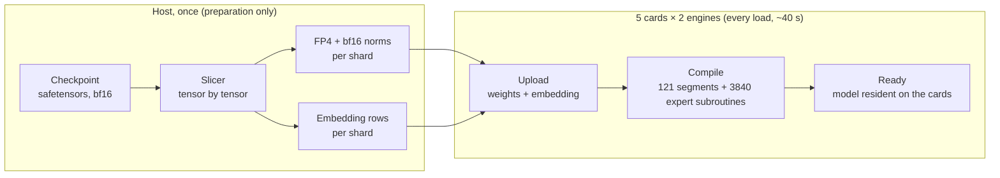
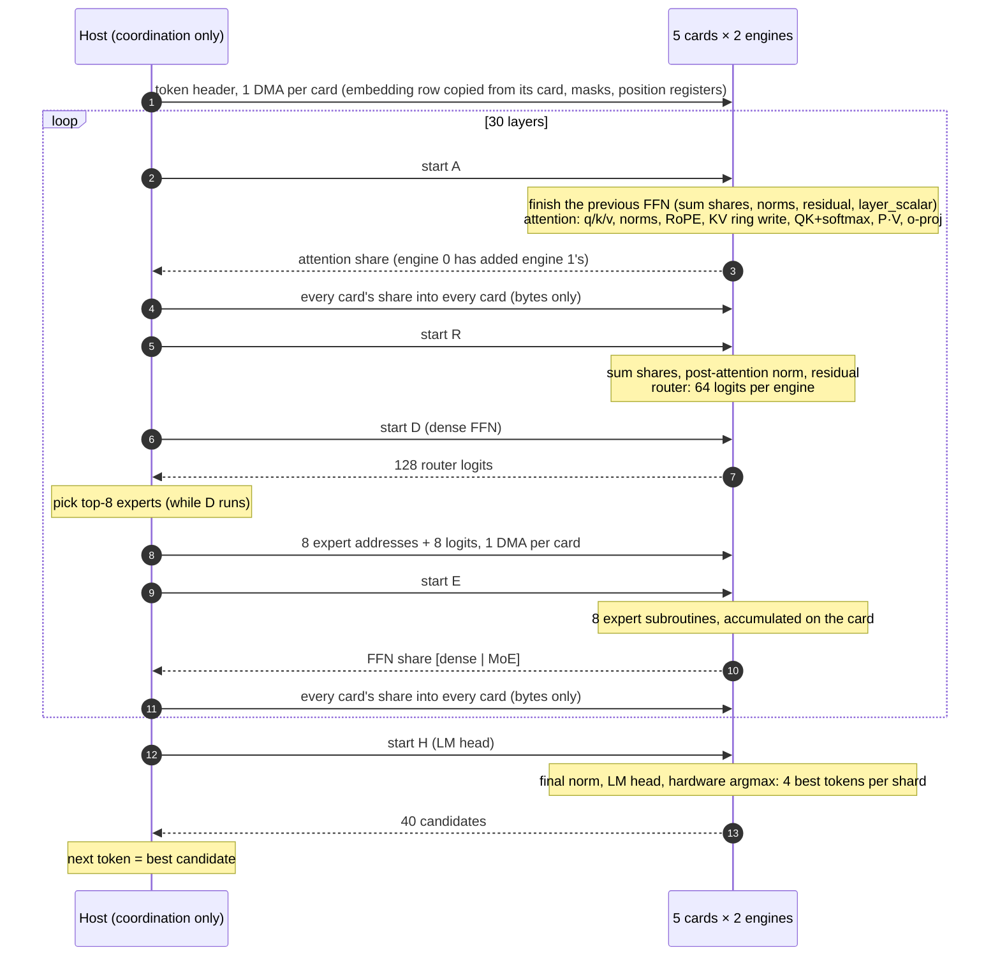
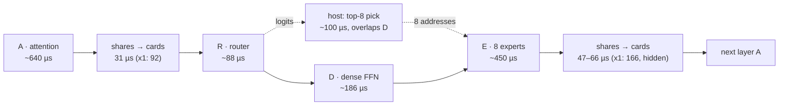

# Findings: LLM inference on 5 Apex Kintex-7 cards

What the measurements taught us. This is not a log of the changes; every statement is backed by a same-session A/B measurement unless it is marked as an estimate.

Setup: HP Z420 (Xeon E5-2689, 32 GB), 5 × Apex Kintex-7 (four on PCIe Gen2 x4, one on x1), 2 engines per card = 10 tensor-parallel shards, FP4 weights, greedy decoding.

## The host CPU and RAM are not used for inference

In every result below, and in OllApeX, **the host CPU does no model arithmetic and the host RAM holds no model data.**

| | Where it lives / runs |
|---|---|
| Weights (all layers, LM head) | Card DRAM |
| Embedding table | Card DRAM (bf16; IF8 for Qwen3.8-27B). The host copies the one row a token needs from the card that holds it, then writes it to all cards. |
| KV cache, attention, FFN, experts, norms, RoPE, softmax, residual sums | Card engines |
| Sum of the shards' partial results | On the cards: each card adds the shares the host copies in. The host only moves the bytes. |

The host only coordinates:
- the tokenizer;
- issuing segment commands and writing position registers;
- moving shares and embedding rows between cards;
- choosing indices from values the cards computed: the top-k experts among the router logits, and the next token among the cards' 4 best candidates per shard.

Two things run on the host outside inference:
- **Slicing**, a one-time preparation step: it reads the checkpoint and writes the per-shard files.
- **The unit tests**, which compare the card output against a torch reference.

Neither runs while generating.

---

## 1. Where the time of a token goes

| Finding | Evidence |
|---|---|
| **The cards are fast; the synchronization around them is the cost.** About a third of every token is host ↔ card synchronization, not compute. | GPT-OSS-20B reads ~1.9 GB of weights per token. At ~66 GB/s over 10 engines (estimate: 5.7 GB/s measured per engine at 198 MHz, scaled to 230 MHz) that is ~29 ms, but a token takes 47 ms. Gemma 4: card compute ~37 ms of 58 ms. |
| **A sync point costs ~0.2–0.3 ms**, and the slowest card sets it. | Per-segment profiles: card round trip minus card compute = 0.25–0.3 ms. |
| **Token speed depends on active parameters, not total size.** | GPT-OSS-20B (3.6B active): 21 tok/s. Gemma 4 26B (3.8B active): 17 tok/s. Qwen3.8-27B (dense): 2.8 tok/s. |
| **The host matters even though it does no model math.** A background CPU hog cost 8.5 %. | A failing desktop autologin loop kept a daemon at 67 % CPU. In text mode GPT-OSS went 51.4 → 47.4 ms/token with identical output. |

## 2. Card clock (firmware 198 → 230 MHz)

| Finding | Evidence |
|---|---|
| **On-card compute scales with the clock in full.** It is not limited by DRAM (an earlier estimate of only 5–10 % was wrong). | Card compute per token dropped by 14.3–14.4 % (198/230 = 0.86) on Qwen 9B and 27B. |
| **The gain per token is smaller (+4.5 % to +11 %)** because the sync part does not depend on the card clock. Models with more sync points gain less. | GPT-OSS (73 syncs/token) +4.5 %; Qwen3.5-9B +11.4 %. |
| **Output is bit-identical across firmware versions.** | Same greedy text and the same token ids on all three models. |
| **On this host, never warm-boot a card while the system runs.** | The vendor's one-step `update_fpga.sh` (warm boot + PCIe rescan of all cards) froze the host. `update_flash.py --no-boot` on each card, then a power cycle, worked on all 5 cards with no problem. |
| **A software reboot does not reload the FPGA images**; a power cycle does. | All cards came up on the new image only after poweroff and power-on. |

## 3. MoE models on these cards

| Finding | Evidence |
|---|---|
| **Expert selection forces a host round trip per layer.** The ISA has no path from a computed value (argmax index, DRAM data) into a control register. | ISA read: 34 instructions, none moves data into a GPR; flags work only between engines. |
| **That round trip can be hidden behind work that does not need the pick.** | Gemma 4: dense FFN started before the pick, pick done while it runs → −2.9 ms/token, the pick (100 µs) fully hidden. |
| **Splitting a large router over the card's two engines helps**; splitting a small one does not. | Gemma (128 experts, bf16): −2.0 ms/token. GPT-OSS (32 experts padded to 64 lanes): no gain possible. |
| **Hardware argmax tracks only 4 ranks**, so a top-8 model needs a host-side sort of the router logits. | Gemma 4 picks 8 of 128 experts. |
| **Card-local picking is safe.** Every card computes the same router from the same summed residual, so all cards pick the same experts. | 0 disagreements over thousands of layers, in every run. |
| **Expert neurons must be split in 64-blocks with the remainder rotated.** Otherwise one engine does double work. | Gemma: 704 neurons = 11 blocks over 10 engines; the 11th block rotates by expert and layer. |

## 4. What is cheap and what is not on the card

| Finding | Evidence |
|---|---|
| **Moving and adding H-sized vectors on the card is cheap** (~2 µs each). | Fusing per-expert copy / scale / add into the GEMV bias path saved only 17 µs per layer (0.6 ms/token). |
| **The fixed cost is the start-up of each small matmul.** 24 small expert GEMVs per layer cannot be merged, because the picked experts are not contiguous. | E segment: ~520 µs of weight reads plus ~110 µs of overhead. |
| **The LM head of a large vocabulary is a fixed ~6 ms/token** (bandwidth bound). Skipping it while reading the prompt is free speed. | Gemma 262K vocab: 5.7 ms. Prompt reading runs faster than generation on GPT-OSS and Gemma. |

## 5. PCIe and data exchange

| Finding | Evidence |
|---|---|
| **The x1 card is on the critical path wherever it has work**, and is hidden where it has none. | Profile: its share writes take 85–166 µs vs 29–66 µs on the x4 cards. In Gemma's attention segment (no heads on that card) the delay disappears; in the router segment it costs ~2 ms/token. |
| **Writing each share as soon as it arrives makes things slower**, because the shares arrive almost together and 4 small DMAs cost more than one large one. | Gemma: 61.7 → 66.3 ms/token. Not to be ported. |
| **The cards' firmware links at x4, though three slots offer x8/x16** (Kintex-7 supports Gen2 x8). This would not help the x1 card, which bounds every sync. | `lspci`: card LnkCap Gen2 x4; root ports x8/x16 Gen3. |
| **Copying an embedding row from a card costs nothing measurable.** | GPT-OSS 47.4 → 47.3 ms/token; Gemma identical tokens; the host table (1.2–2.5 GB) is gone from RAM. |

## 6. Memory per engine (one 2 GiB DDR channel)

| Finding | Evidence |
|---|---|
| **The channel is the hard limit.** Weights + KV + program must fit 2147 MB per engine. | Gemma at 8K did not fit until the KV was shrunk; Qwen 27B with a bf16 embedding does not fit at all. |
| **A sliding-window layer needs only window + 64 rows of KV** (a ring), which also keeps its attention time flat. | Gemma: KV 157 MB (4K) → 168 MB at 8K; sliding attention stays at ~754 µs once the window is full; correct through the wrap (1200-position test). |
| **The real weight-region overhead is the on-disk size + ~31 MB.** The default margin (×1.03 + 96 MB) wastes ~100 MB per engine. | Qwen 27B: 1577 MB of files → 1608 MB on the card. |
| **A margin below the real need corrupts the layout and produces DMA timeouts.** A margin of +64 MB is safe. | Slack +16 MB: xdma H2C timeouts on two cards. Slack +64 MB: no timeouts. All cards passed a write/read DMA check afterwards. |
| **An IF8 embedding table costs almost no quality** and makes Qwen 27B fit at 8K. | Row error 0.65–1.05 % (dequantized on the card). The first 24–30 generated tokens are identical to the bf16 version, then the wording diverges; same speed (2.76 tok/s). |

## 7. Accuracy of the card computation

| Finding | Evidence |
|---|---|
| **The hardware GELU is accurate enough for tanh-GELU models**, if it is applied as a separate identity matmul rather than fused into a GEMV. | Gemma unit test: FFN error 0.4–2 % against torch with the same FP4 weights; the next token is the same. |
| **Head-dimension permutation is an exact way to do partial RoPE** with rotated pairs (i, i + head_dim/2). | Gemma global layers: attention error 0.6–0.9 %, same as the sliding layers. |
| **bf16 attention error grows with long, flat attention**, up to ~4 % with random inputs over 1000+ keys. Real text has sharper attention. | Gemma ring test at 1200 positions. |

## 8. Gemma 4 26B-A4B: how it is sliced and compiled

### Slicing (host-side preparation, once)

**Source and output:**
- The source is `google/gemma-4-26b-a4b-it`, 30 layers: 25 sliding (window 1024, head_dim 256, 8 KV heads) and 5 global (head_dim 512, 2 KV heads, K = V).
- MoE has 128 experts with top-8, 704 neurons each, plus a parallel dense FFN (2112 neurons) in every layer.
- Every weight becomes the card's FP4 (E2M1, one bf16 scale per 64 values along K).
- The checkpoint shard (50 GB) is larger than RAM, so tensors are read one at a time by byte offset; no mmap of the file.

**Layout over the 10 shards** (shard k = engine k % 2 of card k // 2; card 4 is the x1 card):

| Part | Layout |
|---|---|
| Attention | **Shards 0–7 only**, 2 query heads each. Sliding layers: KV head k (no duplication). Global layers: KV head k // 4. **Shards 8–9 (the x1 card) carry no attention**, so their slow link is hidden in that segment. |
| Dense FFN | 33 blocks of 64 neurons: shards 0–2 hold 4 blocks, shards 3–9 hold 3. |
| Experts | 11 blocks of 64 neurons per expert. Shard k holds block k of every expert. Block 10 of expert e goes to one of shards 3–9, rotating with (e + layer), so the extra work spreads over the shards with fewer dense blocks. Per engine: ~1.2 GB of experts. |
| Router | Full copy per card, bf16. `router.scale × hidden^-0.5` is folded into its columns. The card's two engines compute 64 of the 128 logits each. |
| Expert weights | `per_expert_scale` is folded into each expert's down matrix (an exact uniform scale). On the card: softmax over the 8 picked logits = the model's renormalized top-8. |
| Norms, layer_scalar | Kept as bf16 vectors / numbers, applied on the card. They are not folded into FP4 matrices, because a per-64-block scale cannot absorb a varying per-column weight without extra error. |
| LM head (tied) and embedding | 64-row vocabulary blocks over all 10 shards: the LM head in FP4, and the √2816-scaled bf16 embedding rows (148 MB per shard) for the card-side table. |

**Size per engine:** 1.43–1.58 GB of weights + embedding. KV at 8K: 168 MB.

### Card program (compiled at every load, ~40 s)

**Segments** (4 per layer + head = 121 per token, each ending in a halt):

| Segment | Work |
|---|---|
| **A** | Finish the previous layer's FFN: the dense and MoE shares are summed in one 2H pass, then `post_ff_norm_1/2`, add, `post_ff_norm`, residual add, `× layer_scalar`. Then attention. |
| **R** | Sum the attention shares, `post_attention_norm`, residual add, then the router (half per engine). |
| **D** | Dense FFN. It needs no expert pick, so the host starts it right after R and picks the experts while it runs. |
| **E** | The 8 picked experts. |
| **H** | Final norm and LM head, then the hardware argmax gives the 4 best tokens per shard. |

**Experts:**
- Every (layer, expert) is a precompiled subroutine on each engine: 3840 per engine.
- E calls them by register (`jump_reg_abs`). The host writes the 8 subroutine addresses and the 8 logits into E's data slots with one DMA per card.
- Inside a subroutine: one GEMV for gate and up together, GELU as an identity matmul (not fused into the GEMV), the expert weight on its 64–128 hidden values, and the down GEMV accumulating through its bias input straight into the MoE share.

**Attention:**
- Both heads of a shard are computed in **one** QK + softmax matmul with a shared mask row, and **one** P·V matmul over a packed Vᵀ with a runtime length.
- Global layers permute each head's dimensions at load time, so the rotated pairs (i, i+256), i < 64, come first. q, k, q_norm, k_norm and the o-projection columns are permuted the same way, which is exact.
- Sliding layers keep K / V / Vᵀ in a **1088-row ring** (window + 64), with slot-based registers. Because 1088 is a multiple of 64, the same two 64-wide mask templates serve the ring rows and the position-based global rows.

**Per-token inputs:**
- RoPE tables live on the card; each token, a register-addressed copy moves the position's cos / sin rows into fixed slots.
- The host writes one header per token start with one DMA: the embedding row (copied from the card that holds it), two mask templates and 14 position registers.

**Card-side sums:**
- Engine 0 of each card adds engine 1's share before the host reads it (one read per card).
- Every card then sums all cards' shares itself.

**Program size:** 3.2 MB per engine.

### Pipeline: from checkpoint to a running model

### Pipeline of one token

Who does what, in order. The cards compute; the host (H) only moves bytes and picks indices.

### Time per layer (Gemma 4, 230 MHz, measured)

| Step | Time | Note |
|---|---|---|
| A, sliding layer | ~640 µs | Global layer ~915 µs at short context; grows with context |
| Shares to the cards before R | 31 µs (x4) / 92 µs (x1) | The x1 card is on the critical path here |
| R, router | ~88 µs | Was 144 µs before the split over two engines |
| D, dense FFN | ~186 µs | The expert pick (~100 µs on the host) runs at the same time |
| E, 8 experts | ~450 µs | |
| Shares to the cards before the next A | 47–66 µs (x4) / 166 µs (x1) | The x1 card has no attention work, so this is hidden |
| LM head, once per token | ~5.7 ms | 262K vocabulary; skipped while reading the prompt |

**Per token:** 30 layers + LM head + syncs = **~58 ms, about 17 tok/s**.

---

## Final numbers (230 MHz, text mode, greedy)

| Model | Active / total | Context | Generation | Embedding |
|---|---|---|---|---|
| GPT-OSS-20B | 3.6B / 21B (MoE) | 8192 | **21.1 tok/s** | on the cards, bf16 |
| Gemma 4 26B-A4B | 3.8B / 25B (MoE) | 8192 | **17.1–17.3 tok/s** | on the cards, bf16 |
| Qwen3.5-9B | 9B (dense) | 16384 | **7.35 tok/s** | on the cards, bf16 |
| Qwen3.8-27B | 27B (dense) | 8192 | **2.76 tok/s** | on the cards, IF8 |

## What would move the numbers further (vendor side)

| Request | Why | Expected effect (estimate) |
|---|---|---|
| `REG_FROM_ARGMAX Rd, rank` (ranks up to 8) | MoE routing entirely on the card: no host round trip per layer | GPT-OSS ~−7 ms/token (~+15 %) |
| A direct card-to-card link (PCIe peer-to-peer or the GTX transceivers) | Synchronization without the host | Up to a third of every token |
| PCIe Gen2 x8 firmware | Twice the bandwidth on the 3 cards in x8/x16 slots | Small: the x1 card still bounds each sync |
| A safe, documented update path (no warm boot, or a rescan of only the updated card) | The one-step script froze this host | Operational |
