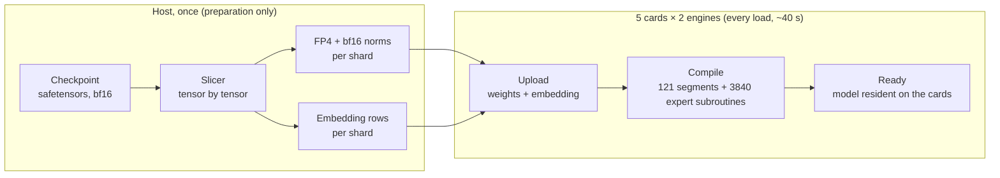
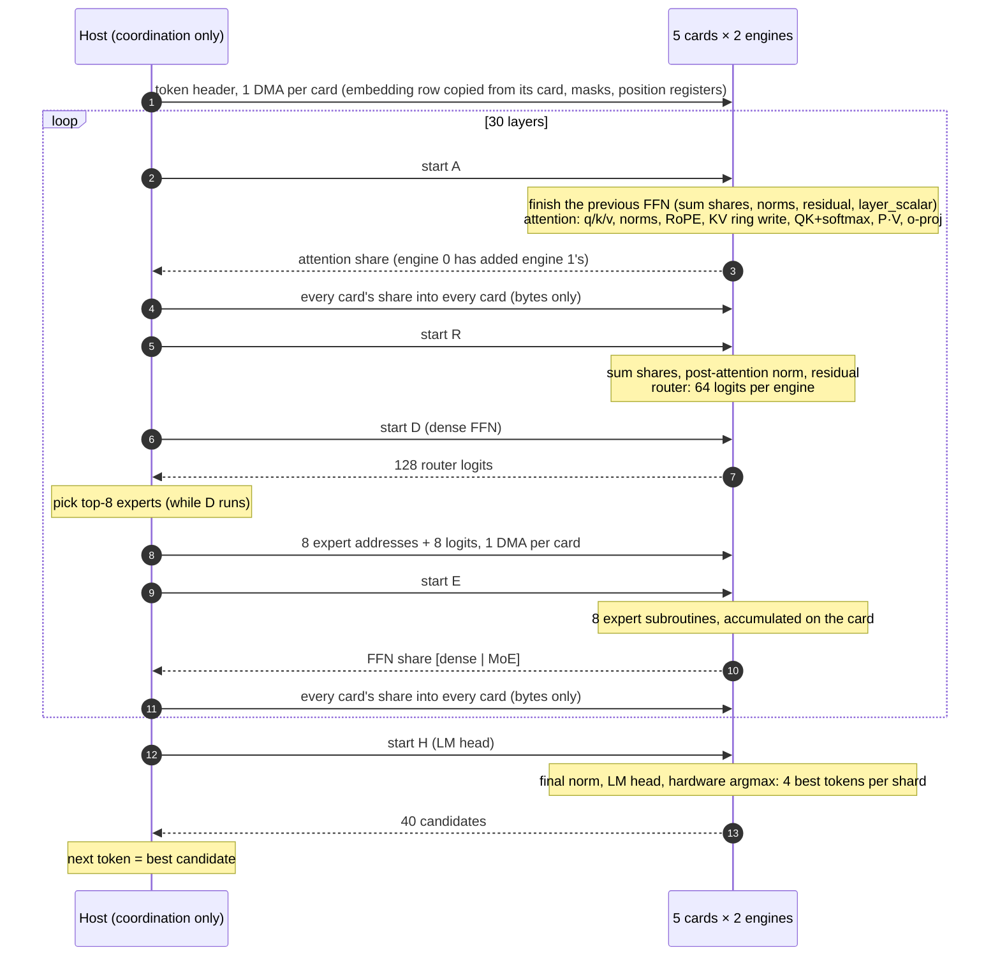
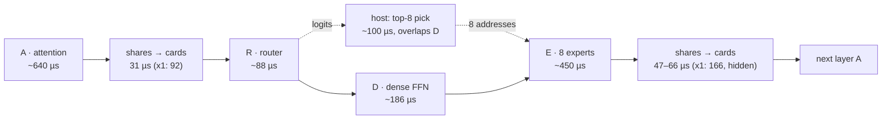
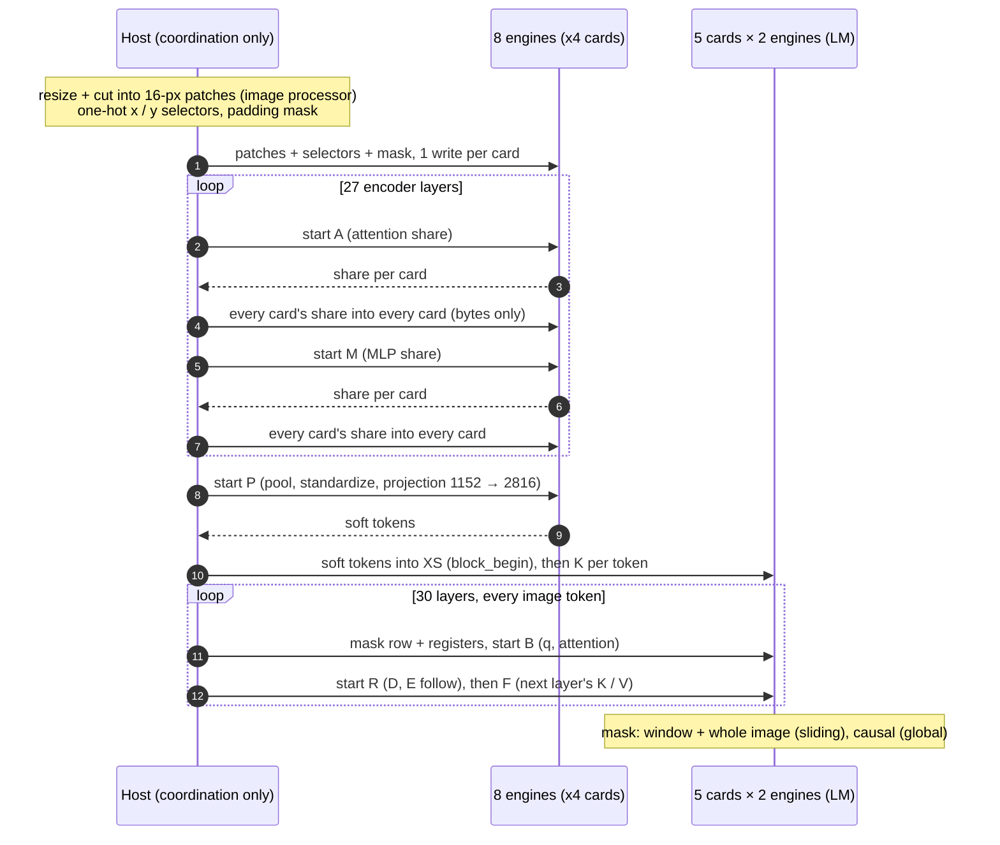

# Findings: LLM inference on 5 Apex Kintex-7 cards

What the measurements taught us. This is not a log of the changes; every statement is backed by a same-session A/B measurement unless it is marked as an estimate.

Setup: HP Z420 (Xeon E5-2689, 32 GB), 5 × Apex Kintex-7 (four on PCIe Gen2 x4, one on x1), 2 engines per card = 10 tensor-parallel shards, FP4 weights, greedy decoding.

## The host CPU and RAM are not used for inference

In every result below, and in OllApeX, **the host CPU does no model arithmetic and the host RAM holds no model data.**

| | Where it lives / runs |
|---|---|
| Weights (all layers, LM head) | Card DRAM |
| Embedding table | Card DRAM (bf16; IF8 for Qwen3.8-27B). The host copies the one row a token needs from the card that holds it, then writes it to all cards. |
| KV cache, attention, FFN, experts, norms, RoPE, softmax, residual sums | Card engines |
| Sum of the shards' partial results | On the cards: each card adds the shares the host copies in. The host only moves the bytes. |
| Image encoder (Gemma 4) | Card DRAM and engines: its weights, the position and RoPE tables, all 27 layers, pooling and the projection into the language model ([§9](#9-gemma-4-images-the-encoder-and-the-image-block-on-the-cards)). |
| Object detector (YOLO26s-OBB) | Card DRAM and engines: its weights, every convolution, the attention block and the detection heads, on every engine next to Gemma 4 ([§10](#10-object-detection-next-to-gemma-4-yolo26s-obb-on-the-same-cards)). The host resizes and packs the frame and turns the head values into boxes. |

The host only coordinates:
- the tokenizer, and for images the model's image processor (resize, cut into patches) plus one-hot selectors and a padding mask built from the patch coordinates;
- issuing segment commands and writing position registers;
- moving shares and embedding rows between cards;
- choosing indices from values the cards computed: the top-k experts among the router logits, and the next token among the cards' 4 best candidates per shard.

Two things run on the host outside inference:
- **Slicing**, a one-time preparation step: it reads the checkpoint and writes the per-shard files.
- **The unit tests**, which compare the card output against a torch reference.

Neither runs while generating.

---

## 1. Where the time of a token goes

| Finding | Evidence |
|---|---|
| **The cards are fast; the synchronization around them is the cost.** About a third of every token is host ↔ card synchronization, not compute. | GPT-OSS-20B reads ~1.9 GB of weights per token. At ~66 GB/s over 10 engines (estimate: 5.7 GB/s measured per engine at 198 MHz, scaled to 230 MHz) that is ~29 ms, but a token takes 47 ms. Gemma 4: card compute ~37 ms of 58 ms. |
| **A sync point costs ~0.2–0.3 ms**, and the slowest card sets it. | Per-segment profiles: card round trip minus card compute = 0.25–0.3 ms. |
| **Token speed depends on active parameters, not total size.** | GPT-OSS-20B (3.6B active): 21 tok/s. Gemma 4 26B (3.8B active): 17 tok/s. Qwen3.8-27B (dense): 2.8 tok/s. |
| **The host matters even though it does no model math.** A background CPU hog cost 8.5 %. | A failing desktop autologin loop kept a daemon at 67 % CPU. In text mode GPT-OSS went 51.4 → 47.4 ms/token with identical output. |

## 2. Card clock (firmware 198 → 230 MHz)

| Finding | Evidence |
|---|---|
| **On-card compute scales with the clock in full.** It is not limited by DRAM (an earlier estimate of only 5–10 % was wrong). | Card compute per token dropped by 14.3–14.4 % (198/230 = 0.86) on Qwen 9B and 27B. |
| **The gain per token is smaller (+4.5 % to +11 %)** because the sync part does not depend on the card clock. Models with more sync points gain less. | GPT-OSS (73 syncs/token) +4.5 %; Qwen3.5-9B +11.4 %. |
| **Output is bit-identical across firmware versions.** | Same greedy text and the same token ids on all three models. |
| **On this host, never warm-boot a card while the system runs.** | The vendor's one-step `update_fpga.sh` (warm boot + PCIe rescan of all cards) froze the host. `update_flash.py --no-boot` on each card, then a power cycle, worked on all 5 cards with no problem. |
| **A software reboot does not reload the FPGA images**; a power cycle does. | All cards came up on the new image only after poweroff and power-on. |

## 3. MoE models on these cards

| Finding | Evidence |
|---|---|
| **Expert selection forces a host round trip per layer.** The ISA has no path from a computed value (argmax index, DRAM data) into a control register. | ISA read: 34 instructions, none moves data into a GPR; flags work only between engines. |
| **That round trip can be hidden behind work that does not need the pick.** | Gemma 4: dense FFN started before the pick, pick done while it runs → −2.9 ms/token, the pick (100 µs) fully hidden. |
| **Splitting a large router over the card's two engines helps**; splitting a small one does not. | Gemma (128 experts, bf16): −2.0 ms/token. GPT-OSS (32 experts padded to 64 lanes): no gain possible. |
| **Hardware argmax tracks only 4 ranks**, so a top-8 model needs a host-side sort of the router logits. | Gemma 4 picks 8 of 128 experts. |
| **Card-local picking is safe.** Every card computes the same router from the same summed residual, so all cards pick the same experts. | 0 disagreements over thousands of layers, in every run. |
| **Expert neurons must be split in 64-blocks with the remainder rotated.** Otherwise one engine does double work. | Gemma: 704 neurons = 11 blocks over 10 engines; the 11th block rotates by expert and layer. |

## 4. What is cheap and what is not on the card

| Finding | Evidence |
|---|---|
| **Moving and adding H-sized vectors on the card is cheap** (~2 µs each). | Fusing per-expert copy / scale / add into the GEMV bias path saved only 17 µs per layer (0.6 ms/token). |
| **The fixed cost is the start-up of each small matmul.** 24 small expert GEMVs per layer cannot be merged, because the picked experts are not contiguous. | E segment: ~520 µs of weight reads plus ~110 µs of overhead. |
| **The LM head of a large vocabulary is a fixed ~6 ms/token** (bandwidth bound). Skipping it while reading the prompt is free speed. | Gemma 262K vocab: 5.7 ms. Prompt reading runs faster than generation on GPT-OSS and Gemma. |

## 5. PCIe and data exchange

| Finding | Evidence |
|---|---|
| **The x1 card is on the critical path wherever it has work**, and is hidden where it has none. | Profile: its share writes take 85–166 µs vs 29–66 µs on the x4 cards. In Gemma's attention segment (no heads on that card) the delay disappears; in the router segment it costs ~2 ms/token. |
| **Writing each share as soon as it arrives makes things slower**, because the shares arrive almost together and 4 small DMAs cost more than one large one. | Gemma: 61.7 → 66.3 ms/token. Not to be ported. |
| **The cards' firmware links at x4, though three slots offer x8/x16** (Kintex-7 supports Gen2 x8). This would not help the x1 card, which bounds every sync. | `lspci`: card LnkCap Gen2 x4; root ports x8/x16 Gen3. |
| **Copying an embedding row from a card costs nothing measurable.** | GPT-OSS 47.4 → 47.3 ms/token; Gemma identical tokens; the host table (1.2–2.5 GB) is gone from RAM. |

## 6. Memory per engine (one 2 GiB DDR channel)

| Finding | Evidence |
|---|---|
| **The channel is the hard limit.** Weights + KV + program must fit 2147 MB per engine. | Gemma at 8K did not fit until the KV was shrunk; Qwen 27B with a bf16 embedding does not fit at all. |
| **A sliding-window layer needs only window + 64 rows of KV** (a ring), which also keeps its attention time flat. | Gemma: KV 157 MB (4K) → 168 MB at 8K; sliding attention stays at ~754 µs once the window is full; correct through the wrap (1200-position test). |
| **The real weight-region overhead is the on-disk size + ~31 MB.** The default margin (×1.03 + 96 MB) wastes ~100 MB per engine. | Qwen 27B: 1577 MB of files → 1608 MB on the card. |
| **A margin below the real need corrupts the layout and produces DMA timeouts.** A margin of +64 MB is safe. | Slack +16 MB: xdma H2C timeouts on two cards. Slack +64 MB: no timeouts. All cards passed a write/read DMA check afterwards. |
| **An IF8 embedding table costs almost no quality** and makes Qwen 27B fit at 8K. | Row error 0.65–1.05 % (dequantized on the card). The first 24–30 generated tokens are identical to the bf16 version, then the wording diverges; same speed (2.76 tok/s). |

## 7. Accuracy of the card computation

| Finding | Evidence |
|---|---|
| **The hardware GELU is accurate enough for tanh-GELU models**, if it is applied as a separate identity matmul rather than fused into a GEMV. | Gemma unit test: FFN error 0.4–2 % against torch with the same FP4 weights; the next token is the same. |
| **Head-dimension permutation is an exact way to do partial RoPE** with rotated pairs (i, i + head_dim/2). | Gemma global layers: attention error 0.6–0.9 %, same as the sliding layers. |
| **bf16 attention error grows with long, flat attention**, up to ~4 % with random inputs over 1000+ keys. Real text has sharper attention. | Gemma ring test at 1200 positions. |

## 8. Gemma 4 26B-A4B: how it is sliced and compiled

### Slicing (host-side preparation, once)

**Source and output:**
- The source is `google/gemma-4-26b-a4b-it`, 30 layers: 25 sliding (window 1024, head_dim 256, 8 KV heads) and 5 global (head_dim 512, 2 KV heads, K = V).
- MoE has 128 experts with top-8, 704 neurons each, plus a parallel dense FFN (2112 neurons) in every layer.
- Every weight becomes the card's FP4 (E2M1, one bf16 scale per 64 values along K).
- The checkpoint shard (50 GB) is larger than RAM, so tensors are read one at a time by byte offset; no mmap of the file.

**Layout over the 10 shards** (shard k = engine k % 2 of card k // 2; card 4 is the x1 card):

| Part | Layout |
|---|---|
| Attention | **Shards 0–7 only**, 2 query heads each. Sliding layers: KV head k (no duplication). Global layers: KV head k // 4. **Shards 8–9 (the x1 card) carry no attention**, so their slow link is hidden in that segment. |
| Dense FFN | 33 blocks of 64 neurons: shards 0–2 hold 4 blocks, shards 3–9 hold 3. |
| Experts | 11 blocks of 64 neurons per expert. Shard k holds block k of every expert. Block 10 of expert e goes to one of shards 3–9, rotating with (e + layer), so the extra work spreads over the shards with fewer dense blocks. Per engine: ~1.2 GB of experts. |
| Router | Full copy per card, bf16. `router.scale × hidden^-0.5` is folded into its columns. The card's two engines compute 64 of the 128 logits each. |
| Expert weights | `per_expert_scale` is folded into each expert's down matrix (an exact uniform scale). On the card: softmax over the 8 picked logits = the model's renormalized top-8. |
| Norms, layer_scalar | Kept as bf16 vectors / numbers, applied on the card. They are not folded into FP4 matrices, because a per-64-block scale cannot absorb a varying per-column weight without extra error. |
| LM head (tied) and embedding | 64-row vocabulary blocks over all 10 shards: the LM head in FP4, and the √2816-scaled bf16 embedding rows (148 MB per shard) for the card-side table. |

**Size per engine:** 1.43–1.58 GB of weights + embedding. KV at 8K: 168 MB.

### Card program (compiled at every load, ~40 s)

**Segments** (4 per layer + head = 121 per token, each ending in a halt):

| Segment | Work |
|---|---|
| **A** | Finish the previous layer's FFN: the dense and MoE shares are summed in one 2H pass, then `post_ff_norm_1/2`, add, `post_ff_norm`, residual add, `× layer_scalar`. Then attention. |
| **R** | Sum the attention shares, `post_attention_norm`, residual add, then the router (half per engine). |
| **D** | Dense FFN. It needs no expert pick, so the host starts it right after R and picks the experts while it runs. |
| **E** | The 8 picked experts. |
| **H** | Final norm and LM head, then the hardware argmax gives the 4 best tokens per shard. |

**Experts:**
- Every (layer, expert) is a precompiled subroutine on each engine: 3840 per engine.
- E calls them by register (`jump_reg_abs`). The host writes the 8 subroutine addresses and the 8 logits into E's data slots with one DMA per card.
- Inside a subroutine: one GEMV for gate and up together, GELU as an identity matmul (not fused into the GEMV), the expert weight on its 64–128 hidden values, and the down GEMV accumulating through its bias input straight into the MoE share.

**Attention:**
- Both heads of a shard are computed in **one** QK + softmax matmul with a shared mask row, and **one** P·V matmul over a packed Vᵀ with a runtime length.
- Global layers permute each head's dimensions at load time, so the rotated pairs (i, i+256), i < 64, come first. q, k, q_norm, k_norm and the o-projection columns are permuted the same way, which is exact.
- Sliding layers keep K / V / Vᵀ in a **1088-row ring** (window + 64), with slot-based registers. Because 1088 is a multiple of 64, the same two 64-wide mask templates serve the ring rows and the position-based global rows.

**Per-token inputs:**
- RoPE tables live on the card; each token, a register-addressed copy moves the position's cos / sin rows into fixed slots.
- The host writes one header per token start with one DMA: the embedding row (copied from the card that holds it), two mask templates and 14 position registers.

**Card-side sums:**
- Engine 0 of each card adds engine 1's share before the host reads it (one read per card).
- Every card then sums all cards' shares itself.

**Program size:** 3.2 MB per engine.

### Pipeline: from checkpoint to a running model

### Pipeline of one token

Who does what, in order. The cards compute; the host (H) only moves bytes and picks indices.

### Time per layer (Gemma 4, 230 MHz, measured)

| Step | Time | Note |
|---|---|---|
| A, sliding layer | ~640 µs | Global layer ~915 µs at short context; grows with context |
| Shares to the cards before R | 31 µs (x4) / 92 µs (x1) | The x1 card is on the critical path here |
| R, router | ~88 µs | Was 144 µs before the split over two engines |
| D, dense FFN | ~186 µs | The expert pick (~100 µs on the host) runs at the same time |
| E, 8 experts | ~450 µs | |
| Shares to the cards before the next A | 47–66 µs (x4) / 166 µs (x1) | The x1 card has no attention work, so this is hidden |
| LM head, once per token | ~5.7 ms | 262K vocabulary; skipped while reading the prompt |

**Per token:** 30 layers + LM head + syncs = **~58 ms, about 17 tok/s**.

## 9. Gemma 4 images: the encoder and the image block on the cards

Gemma 4 reads images with its own vision encoder. Both parts run on the cards: the **encoder** (27 transformer layers) tensor-parallel over the 8 engines of the four x4 cards, and the **image block** in the language model with the model's exact attention rule. The host resizes the image and cuts it into patches (the model's own image processor), turns the patch coordinates into one-hot selectors and a padding mask (indices only, no model data), and moves shares between the cards, as for text.

### What the model does (from the checkpoint and `transformers`)

| Part | Detail |
|---|---|
| Patches | 16 × 16 px, 3 × 16 × 16 = 768 values each. Both sides are multiples of 48 (patch × pool 3). At most 9 × S patches for S soft tokens; S = 70, 140 or 280. |
| Patch embedding | `input_proj(2 · (p − 0.5))` plus learned x and y position tables (2 × 10240 × 1152). |
| Encoder | 27 layers, hidden 1152, 16 heads × 72, MLP 4304 (tanh GELU), q / k / v norms, scaling 1.0. **Axial 2D RoPE**: each head is two 36-wide parts (x, then y), each rotated as pairs (i, i + 18). Attention is bidirectional over all patches. |
| Output | 3 × 3 average pool, × √1152, standardize (`std_bias`, `std_scale`), then RMSNorm without weight and a linear 1152 → 2816 into the language model. |
| In the prompt | `<|image>`, one `<|image|>` per soft token, `<image|>`. The soft tokens replace those embeddings directly (no √2816 scaling). Positions stay plain 1D. |
| Language-model mask | Global layers: causal. Sliding layers: `kv > q − 1024` **and** (`kv ≤ q` **or** both tokens in the same image). Inside an image, every token sees the whole image. |

### Precision: IF8, not FP4

Measured on one image (60 soft tokens) against the bf16 encoder:

| Encoder weights | Soft-token error, mean / max | Cosine, min |
|---|---|---|
| IF8 (one scale per 64 values) | **2.1 % / 8.7 %** | 0.996 |
| FP4 | 27 % / 88 % | 0.60 |

FP4, which is fine for the language model, breaks the encoder. Its 27 layers use IF8 (~0.6 GB), and the tables and both projections stay bf16 (`gemma4/extract_gemma4_vision.py` → `vision/vision.pt`, 699 MB, once).

### Encoder layout on the card

- **Head 72 → 128 with permuted dimensions.** Inside a head, x dims 0–17 go to 0–17, x 18–35 to 64–81, y 0–17 to 18–35, and y 18–35 to 82–99, with the rest zero. The card's rotate-half RoPE pairs (j, j + 64), which is then exactly the model's axial RoPE. The q / k / v norm gammas are multiplied by √(72 / 128), so an RMS over 128 padded dims equals the model's RMS over 72. MLP 4304 → 4352 (a multiple of 64).
- **Every table on the card.** The x and y position embeddings and the cos / sin rows of the RoPE live on the card as matrices. The host writes a one-hot selector per patch (its x and y index), and one matmul on the card picks each patch's rows.
- **2p − 1 on the card.** The patch projection is stored doubled, and its bias is minus its row sum, so the card applies `2 · (p − 0.5)` inside the projection.
- **Pooling as contiguous adds.** The host orders the patches by their offset inside the 3 × 3 pool block, so the 9 patches of a soft token are 9 equal-length stripes and the pool is 8 adds. Standardize and the √1152 are one diagonal matmul plus a bias.
- **Padding.** A level has a fixed number of rows (`ceil64(9 · S)`). Unused rows are copies of patch 0, because the card's dynamic RMS has no epsilon and a zero row would give NaN. An additive mask removes them from attention.

### Tensor-parallel encoder (8 engines)

- Every shard keeps the full X (rows × 1152). It owns some of the 16 heads and some 64-neuron blocks of the MLP, balanced so that attention and MLP time per shard are close.
- **Two segments per layer, each ending in a halt:** A (attention share) and M (MLP share), then one P segment for pool and projection. Engine 0 adds engine 1's share on the card, the host copies each card's share to every card (bytes only), and every card sums them itself, the same scheme as the language model.
- **One program per level.** The row layout of a level is fixed (row j · S + m for pool offset j and soft token m), so the programs for 70, 140 and 280 are compiled once at load: 7 / 13 / 39 MB per engine.
- The inputs (patches, one-hot selectors, mask) and the share buffers sit in the weight region, because some engines have only ~100 MB of tensor region left after the language model.

### The image block in the language model (exact)

A token-by-token prompt read cannot do the image rule: an early image token must see later image tokens that are not read yet. The block mode reads the image **layer by layer** instead:

1. **block_begin:** the soft tokens go into a per-token X buffer on the card (XS), one write per card.
2. **K**, for every image token: layer 0's K / V into the cache.
3. For each of the 30 layers, for every image token:
   - **B:** q and attention, with a mask row the host writes for that token: the sliding window plus the whole image, or causal in the global layers.
   - **R / D / E:** router, dense FFN, experts, as in the normal program.
   - **F:** finish the FFN, write the **next** layer's K / V, and store the token's X back into XS.

   So all K / V of a layer exist before any image token attends in that layer.
4. **block_end** rewrites the normal mask rows, and text continues with the normal program.

- It is a separate block program per shard; the normal per-token program and its instruction order are unchanged.
- The sliding ring grows from window + 64 to **window + 64 + 288 = 1376 rows**, so a full image fits next to the window.
- **Unit test** (`tools/test_gemma4_block.py`: window shrunk to 128; 250 text, 90 image, 4 text tokens): block attention error ≤ 3.9 %, the same as text tokens. The first image token sees 217 keys and the last one 128, which is the model's rule. The text after the image is correct.

### Image pipeline

### Results (230 MHz, people.jpg 612 × 408)

**Accuracy:**

| Check | Result |
|---|---|
| Encoder, each layer alone vs a torch emulation of the same IF8 weights | 0.2–0.6 % (tensor-parallel: 0.57 % after one layer) |
| Soft tokens, tensor-parallel card vs the emulation | mean 6.0 %, max 27.7 %, the same as on one engine |
| Soft tokens, card vs the bf16 model in fp32 | mean 6.4 %, max 36 %, cosine ≥ 0.934. For scale: the model's own bf16 path vs fp32 gives 3.1 % / 15 % / 0.988. |
| End to end (OllApeX, greedy) | A correct description at every level: group photo in a park, rows sitting and standing, clothes and hair of the front row. Count of people: 14 / 16 / 17 at 70 / 140 / 280 tokens; the photo shows about 15. |

**Speed** (the encoder alone):

| Level (soft tokens) | Patches (rows) | 10 engines | **8 engines (x4 cards)** |
|---|---|---|---|
| 70 | 540 (640) | 5.97 s | **5.29 s** |
| 140 | 1134 (1280) | 12.9 s | **11.4 s** |
| 280 | 2340 (2560) | 29.3 s | **26.5 s** |

- Reading the image block costs about the same per token as reading text (~60 ms per image token, the block is processed token by token in each layer): 60 tokens in ~3.7 s.
- Generation speed after an image is unchanged: 16.6–17.1 tok/s.
- Loading Gemma 4 with image support takes ~160 s instead of ~47 s (encoder weights plus the three level programs).

### What we learned

| Finding | Evidence |
|---|---|
| **The encoder is compute-bound, not link-bound.** Leaving out the x1 card makes it faster. | 8 engines beat 10 at every level by ~10 %. The 16 heads split evenly over 8, and the x1 link drops out of every sync. ~12 GMAC/s per engine; the head pad 72 → 128 wastes part of it. |
| **FP4 is not enough for a vision encoder.** | 27 % mean token error with FP4 against 2.1 % with IF8. |
| **An exact bidirectional block fits the per-token machinery.** It only needs the K / V of all block tokens before their attention, and a per-token mask row. | Block error ≤ 3.9 %, the same as text; the visible-key counts match the model's rule. |
| **Pad and permute instead of new kernels.** Axial 2D RoPE, 72-wide heads and the patch normalization all map onto existing card operations by moving dimensions at slicing time. | Each encoder layer 0.2–0.6 % against the emulation. |
| **Chat templates can break prefix reuse.** Gemma's template opens each model turn with an empty thinking block but drops it when the turn is in the history, so a re-rendered chat never matches what the cards hold. OllApeX builds a follow-up as the exact continuation instead. | A follow-up question about an image: 278 of 301 tokens reused, 1.8 s instead of 16.8 s. |
| **Memory is the limit for higher detail.** | After the language model, the encoder and its three programs: 46 MB of tensor region left on the tightest engine, and 4 MB of program region on engine 1 of each card. |

## 10. Object detection next to Gemma 4: YOLO26s-OBB on the same cards

A second network shares the cards with the language model: **YOLO26s-OBB** (oriented boxes, the 15 DOTA classes: plane, ship, storage tank, harbor, bridge, large / small vehicle, helicopter, …), unmodified pretrained weights, 640 × 640 input. Every engine holds its own full copy in the memory the language model leaves free, so **10 engines detect in parallel while Gemma 4 26B-A4B stays loaded**, and Gemma can then talk about what was found. Code: `yolo26/` (compiler, per-engine build, frame bus), `SEG_YOLO` in `gemma4/gemma4_tp.py`, and the detection page `ollapex/ollapex_yolo.py` + `ollapex/static/yolo.html`.

### Method

| Part | How |
|---|---|
| Card operations | The vendor's native CONV2D and MAXPOOL opcodes (queue-CONFIG geometry) and its YOLOv5 emitters (conv, maxpool, nearest upsample, add, concat). The attention block (C2PSA) is a transpose plus two matmuls with the softmax fused into the first, as in the language model. |
| Graph lowering | 195 operations, 136 convolutions. Splits and chunks become convolutions over channel ranges, depthwise convolutions become dense convolutions with a diagonal weight, and the three last convolutions of each head level are merged into one (4 box + 15 class + 1 angle channels). The head uses the model's NMS-free one-to-one branch. |
| Input | 2 × 2 space-to-depth: the 640 × 640 image becomes 320 × 320 with 12 channels and the stem convolution is rewritten to match, so the input is 13 MB instead of 52 MB. |
| Precision | IF8 weights with one scale per output channel. |
| Placement | The program is relocatable: weights and program go into the free part of each engine's weight region, tensors into its free tensor region, with buffer reuse. Per engine: **52.2 MB** weights + program and **35.5 MB** tensors. |
| Time slicing | The program is cut into **1096 units of ~4 ms** (longest measured 6.1 ms), each ending in a halt. It uses only operation, configuration, halt and no-op instructions, no registers or jumps, so a frame can stop between any two units and the language model's program runs in between. |
| Scheduling | A shared-memory frame bus (16 slots) between the web server, the driver and the card processes. Camera frames: after every Gemma token, 20 ms of detector units on every engine, so both run at the same time. Uploaded images and videos: queued, the cards run the detector frames before the next chat command. |
| Host part | Letterbox resize and the space-to-depth packing before the cards; after them, turning the head values into boxes (position + distances × stride, class threshold, best 300) and a greedy IoU tracker across video frames. The network itself runs entirely on the cards. |

### Results (230 MHz, Gemma 4 26B-A4B 8K loaded)

| Measurement | Result |
|---|---|
| Accuracy vs the float model, op by op | Each operation alone: 32–47 dB SNR. The three head outputs after the whole chain: 25–30 dB. |
| Aerial photo of a marina (boats.jpg) | **166 detections** (165 ship, 1 harbor), rotated boxes on the boats |
| One frame on one engine | **3.15 s** card time (weight-stream bound); 3.25 s end to end through the web API |
| Throughput, Gemma idle | **2.56 frames/s** on 10 engines |
| Throughput while Gemma generates (camera mode) | **2.19 frames/s**, Gemma 12.1 tok/s (17.25 without frames). The greedy answer is **identical** to the one without the detector. |
| Video upload | Frames sampled at a chosen rate, each frame through the cards, tracks across frames; unique and peak counts per class |
| Loading Gemma 4 with the detector | ~240 s the first time (includes compiling the detector for each engine's addresses), ~168 s after that (compiled images cached) |

### Talking about the results

The OllApeX detection page (image, video, webcam) has a chat with Gemma 4 about the current result. The first question carries a compact summary instead of every box:
- **Image:** counts per class, a 3 × 3 region grid sorted from most to fewest objects, and the 15 most confident detections (position, size, angle).
- **Video:** counts over time, unique tracked objects, how many moved, and where the 20 longest tracks went.
- **Optional:** the picture itself, through the Gemma 4 image path (§9).

Follow-up questions are exact continuations, so the cards reuse what they already read:

| | Prompt tokens | Reading time | Answer |
|---|---|---|---|
| First question (summary + picture) | 746 | 41 s | "165 boats, most in the top-center region, a marina" (correct) |
| Follow-up "Where are the fewest boats?" | 860 reused | 1.4 s | "top right, 8 boats" (correct) |

### What we learned

| Finding | Evidence |
|---|---|
| **A CNN and an LLM can share the cards without changing each other's results.** Halt-terminated units plus separate memory regions are enough. | Greedy Gemma output identical with and without camera frames; the detector runs on all 10 engines. |
| **Short units let the detector run between tokens.** | 20 ms of units after each token: 2.19 frames/s while Gemma still generates at 12.1 tok/s. |
| **Space-to-depth makes the input fit.** | Input 52 → 13 MB per engine, which is what lets the detector fit next to the language model on every engine. |
| **The prompt summary sets the chat speed.** Prompt reading is ~55–60 ms per token, so the summary is kept to what the questions need, sorted so the model reads the answer directly. | 746 tokens → 41 s for the first answer; follow-ups in seconds. |

---

## Final numbers (230 MHz, text mode, greedy)

| Model | Active / total | Context | Generation | Embedding |
|---|---|---|---|---|
| GPT-OSS-20B | 3.6B / 21B (MoE) | 8192 | **21.1 tok/s** | on the cards, bf16 |
| Gemma 4 26B-A4B | 3.8B / 25B (MoE) | 8192 | **17.1–17.3 tok/s** | on the cards, bf16 |
| Qwen3.5-9B | 9B (dense) | 16384 | **7.35 tok/s** | on the cards, bf16 |
| Qwen3.8-27B | 27B (dense) | 8192 | **2.76 tok/s** | on the cards, IF8 |

Images (Gemma 4, encoder on 8 engines): **5.3 / 11.4 / 26.5 s** at 70 / 140 / 280 soft tokens, then ~60 ms per image token to read the block; generation speed unchanged ([§9](#9-gemma-4-images-the-encoder-and-the-image-block-on-the-cards)).

Object detection (YOLO26s-OBB, 640 px, next to Gemma 4 on all 10 engines): **3.15 s** per frame per engine, **2.56 frames/s** in total, 2.19 frames/s while Gemma generates at 12.1 tok/s with an unchanged answer ([§10](#10-object-detection-next-to-gemma-4-yolo26s-obb-on-the-same-cards)).

## What would move the numbers further (vendor side)

| Request | Why | Expected effect (estimate) |
|---|---|---|
| `REG_FROM_ARGMAX Rd, rank` (ranks up to 8) | MoE routing entirely on the card: no host round trip per layer | GPT-OSS ~−7 ms/token (~+15 %) |
| A direct card-to-card link (PCIe peer-to-peer or the GTX transceivers) | Synchronization without the host | Up to a third of every token |
| PCIe Gen2 x8 firmware | Twice the bandwidth on the 3 cards in x8/x16 slots | Small: the x1 card still bounds each sync |
| A safe, documented update path (no warm boot, or a rescan of only the updated card) | The one-step script froze this host | Operational |
