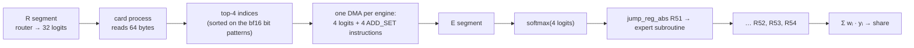
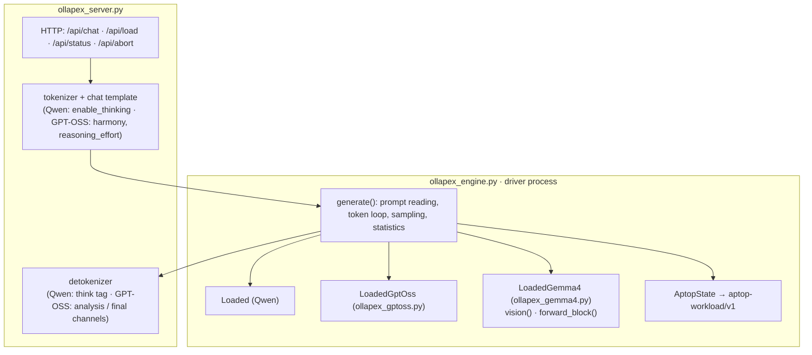

# Technical details

This document continues the [README](../README.md). It covers how the card programs are structured, the register map, the memory layout and the measured timings.

---

## 1. Hardware measurements

The values below were measured with firmware `a4fba9d9` (198 MHz). With firmware `c7de4c55` (230 MHz), the engines' compute time per token is 14 % shorter (198 / 230). Host-side and DMA times do not change ([README](../README.md#firmware-update-198--230-mhz)).

| Measurement | Value |
|---|---|
| Engine compute | 64 MAC / cycle × 198 MHz ≈ 12.7 GMAC/s (230 MHz: ≈ 14.8 GMAC/s) |
| FP4 weight read, one engine | ~5.7 GB/s |
| Two engines, separate DDR channels | 11.38 GB/s total |
| Two engines, same DDR channel | 6.43 GB/s total |
| Small DMA (128–256 B), persistent file, x4 card | 9–12 µs |
| Small DMA, x1 card | 12–13 µs |
| 28.8 KB write (5 shares) | x4: 29 µs · x1: 85 µs |
| 5.7 KB read (1 share) | x4: 12 µs · x1: 25 µs |
| All 5 cards at once, 256 B write/read | 11–16 µs |
| Engine start + idle poll | ~4 µs |

Single-token decoding is bound by the engine's weight read rate. That rate follows the engine clock, not the DDR limit: at 230 MHz the on-card time per token drops by the full clock ratio. Matmul time grows linearly with the number of rows, so batched prompt reading brings no extra speed; the extra compute comes from the second engine.

### Engine addressing

- The AXI‑Lite register block of engine *e* is at `UE_0_BASE_ADDR + e × 0x10000`.
- Address bit 31 selects the DDR channel: 0–2 GiB is channel 0, 2–4 GiB is channel 1.
- Each engine's 2 GiB window holds, in order: parameters (size on disk × 1.05 + 144 MB), then tensors, then the program in the top 64 MB.
- Building an engine object tests the first 16 KB of DRAM. All engines are therefore built before any weights are uploaded.

---

## 2. GPT‑OSS‑20B card program

### Segments

Each engine has one per-token program, divided into segments by `halt` instructions. The host starts a segment, waits for it to finish, exchanges the shares, and starts the next one.

| Segment | Content | Card time on an 8‑head / 320‑neuron slice |
|---|---|---|
| **A0** (token start) | mask update (24 layers), layer 0 attention | ~0.45–0.76 ms |
| **A** (layer *l*) | add shares → RMSNorm → q/k/v → RoPE → KV write → Vᵀ block → QK+softmax → P·V → o | 435–473 µs (grows with context) |
| **R** | add shares → RMSNorm → router (32 logits) | 96 µs |
| **E** | softmax of the 4 logits → 4 expert subroutines → weighted sum | 1083 µs (320 neurons) · 879 µs (256 neurons) |
| **H** | add shares → final norm → LM head (20096 rows) | 5.15 ms |

### Attention steps (8 heads, position ~200)

| Step | Time |
|---|---|
| Add shares (5 shares + residual) | 13.6 µs |
| RMSNorm | 8.2 µs |
| q GEMV 512×2880 | 136 µs |
| k, v GEMV 64×2880 | 2 × 21.5 µs |
| RoPE (8 heads + k) | 22 µs |
| KV write | 4 µs |
| Vᵀ block (64×64 transpose) | 49 µs |
| QK + softmax, all heads (length 320) | 65 µs |
| P·V (length 320) | 37 µs |
| o GEMV 2880×512 | 133 µs |

The card rebuilds Vᵀ every 64 tokens, when the length register grows. This takes 141 µs at length 320 and 422 µs at length 1088, which is a few µs per token on average.

### Expert subroutine (320 neurons)

| Step | Time |
|---|---|
| gate GEMV 320×2880, bias + clamp(max 7) | 87 µs |
| GELU (x·σ(1.702x)) as an identity matmul [5×64]·I₆₄ | 8.6 µs |
| up GEMV 320×2880, bias(+1) + clamp(−6, 8) | 88 µs |
| gate × up (URAM) | 4.3 µs |
| down GEMV 2880×320 (+ bias, slice 0 only) | 85 µs |
| weight and accumulate | 7–8 µs |

- `clamp(up, −7, 7) + 1` is written as `clamp(up + 1, −6, 8)`, and the +1 is added to the up bias.
- The card's LALU activation unit works on matmul outputs, so GELU is computed at the output of an identity matmul on 64×64 blocks.

### Expert selection and call



- One subroutine per (layer, expert) is precompiled for each engine: 24 × 32 subroutines.
- The `ADD_SET` instruction bytes that the host writes are precomputed. The instruction's 32-bit immediate is spread over several words, so its bit layout is learned at startup and checked against a real compile.
- Every card computes the router from the same summed residual with the same weights. The 5 cards' picks are therefore identical, and no extra sync is needed between the cards.

### Register map

| Register | Holds | Written by |
|---|---|---|
| 1 | byte offset of the V row (position) | host, token start |
| 2 | scratch | card |
| 3 | RoPE row offset | host, token start |
| 42 | byte offset of the K' row (128-wide rows) | host, token start |
| 43 | Vᵀ rebuild flag (position % 64 == 0) | host, token start |
| 44, 45 | offset of the new / expiring mask block | host, token start |
| 50 | return address from an expert subroutine | card |
| 51–54 | subroutine addresses of the 4 picked experts | host, per layer |
| 57 | Vᵀ row stride (length × 2 bytes) | card |
| 58, 59 | transpose input / output address | card |
| 60 | visible length (multiple of 64, including the sink block) | host, token start |
| 61, 62 | V block / Vᵀ column offset | host, token start |

The vendor's scratch register allocator counts up from 6. While the card program is compiled, a check ensures it stays below 40.

### Token start: one DMA

At the start of every engine's program there is a data area that the host overwrites:

```
[ embedding row (2880 bf16) | new mask template (64) | expiring mask template (64) | 9 × ADD_SET ]
```

The card reads this area, sets its registers, and updates the mask rows of all 24 layers from the templates.

### Memory budget (per engine, context 8192)

| Region | Size |
|---|---|
| Weights (FP4 + scales + biases) | ~1.0–1.2 GB |
| K' cache (24 × 8704 × 128 × 2 B) | 53 MB |
| V + Vᵀ (24 × 8704 × 64 × 2 B × 2) | 53 MB |
| Program (token program + 768 expert subroutines) | ~1.6 MB |

---

## 3. Qwen3.5 tensor-parallel runtime

### Slicing (10 slices)

| Layer type | Per slice |
|---|---|
| Linear attention | some key heads + the value heads they serve (rows of in_proj_qkv / z / a / b and conv1d; columns of out_proj) |
| Full attention | some query heads + their KV head (rows of q/k/v, columns of o) |
| MLP | a block of the intermediate neurons (rows of gate/up, columns of down) |
| LM head | a block of vocabulary rows |

A slice is itself a narrower layer, so the port's own quantizer handles it unchanged.

### Port patches (`port_build.py`)

| Patch | What it does |
|---|---|
| `silu`, `kpad`, `attn1`, `noeye`, `heads`, `abfuse`, `vtshare`, `recgrp` | Decode-path simplifications (single-row attention, one transpose, grouped state update, …) |
| `shard`, `tp` | One engine holds one slice; the program halts at every residual addition |
| `membase` | Separate, adjustable parameter / tensor / program regions |
| `cardsum` | The shares are added on the card; the residual stays on the card |
| `dynlen` | Attention length from register 60; empty context is not computed |
| `ctx16k` | One copy per KV head, persistent chunked Vᵀ, per-head QK, 16K context |
| `if4mix` | Quantization format chosen with `APEX_Q4` (recommended: `fp4`) |

### Sync points per token

In Qwen every layer has two sync points (attention and MLP), plus the LM head: 65 points for the 9B model and 129 for the 27B model.

---

## 4. Host path

| Technique | Why |
|---|---|
| Shared memory + one command counter | One counter bump wakes all 5 card processes at once |
| Persistent h2c / c2h file per card process, `os.pwrite` / `os.pread` | No device open/close per call |
| Engine start and polling: direct 4-byte `pwrite` / `pread` on the user BAR | No intermediate layers |
| On-card pre-sum (presum): engine 1's share is added on engine 0 | One read and one 5-share write per card |
| Double buffering (segment parity) | The shares of the previous segment stay intact while the next ones are read |
| Expert-pick and token-start buffers built with `struct`, sent in one DMA | No small numpy operations |
| Park mode | Between requests the card processes poll every 0.5 ms |

> Use only `read` / `write` / `pread` / `pwrite` on the xdma character devices. The vectored calls (`preadv` / `pwritev`) go through the driver's asynchronous path, which does not suit this use.

---

## 5. Inside OllApeX



- **Stop tokens:** Qwen uses `<|im_end|>`; GPT‑OSS uses `<|return|>` / `<|call|>`. In GPT-OSS, `<|end|>` closes the analysis message and the final answer follows it.
- **Images:** `/api/file` keeps an uploaded image in `/dev/shm/ollapex_uploads` (id = md5) and reports its size and token cost at each detail level. A chat message carries `images: [id]`, and the image is encoded under the engine lock before the prompt is built.
  - Qwen: the encoder runs on one card, and the image tokens get (t, h, w) rotary positions.
  - Gemma 4: `LoadedGemma4.vision()` runs the encoder on the first `GEMMA4_VISION_SHARDS` shards (default 8) at 70 / 140 / 280 soft tokens. The server expands each `<|image|>` of the chat template to `<|image>` + one `<|image|>` per soft token + `<image|>`, and `generate()` reads each image as one block (`forward_block()`, `req["image_blocks"]`).
  - Encoded images are cached per detail level, so follow-up turns do not encode again.
- **Follow-ups:** when a request is the previous exchange plus one user message, the token ids are built as the exact continuation of what the cards hold, so only the new turn is read.
- **Candidates:** Every engine reports its best 4 tokens through the hardware argmax. Greedy mode takes the largest logit; sampling picks among the overall top‑k candidates with temperature / top‑p.
- **aptop state file:** `$XDG_RUNTIME_DIR/aptop-workload.json` and `/tmp/aptop-$UID/workload.json`. It holds the model, the phase, and the per-card memory split (weights / KV / program).
